

# GHPC Combat Overhaul

**See what your round actually did.**

X-ray kill cam, damage that stays on the vehicles, APFSDS rods that bend and break, explosions at their real size,
a War Thunder style HUD, an Armor Sim, a proving ground and an After Action Report for *Gunner, HEAT, PC!*

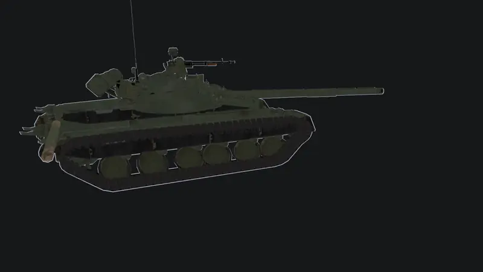

One shot: 3BM32 into the side of a T-80B at 1 km. The spall, the wounded crew, the charges burning in the carousel and the rack going off are all the game's own simulation of that shot.

**[Download](../../releases/latest)** · [Install](#install) · [Settings](#settings-and-presets) · [Keys](#keys)

---

GHPC has the most detailed damage model I've seen in a tank game. Every round is a real projectile with its own speed and penetration, every piece of spall flies on its own, every crewman has hit zones down to his eyes, and the ammo in a burning tank really heats up until it cooks off. And you almost never get to see any of it. You fire, the target stops, maybe it starts smoking, and that's it.

I wanted to see it. So I started with a kill cam like the one in War Thunder, with one rule: nothing in it is made up. The mod records what GHPC simulated on your shot and replays exactly that, in slow motion, on an x-ray copy of the target. Then I kept adding the things I missed while playing, and it grew into a full overhaul.

What it adds:

- **[X-ray kill cam](#x-ray-kill-cam).** After each of your hits, a slow-motion replay on a see-through copy of the target: the plate failing, every spall fragment, the crew and modules it hit, fires and the rack cooking off.
- **[APFSDS with real physics](#apfsds-with-real-physics).** Long rods erode as they push through armour, bend in oblique hits and snap when they glance off, by material (DU, tungsten, steel).
- **[Damage that stays on the vehicles](#damage-that-stays-on-the-vehicles).** Real holes, petals and grooves, holed and torn barrels, tracks that break and fall off, burning engines, flames out of the holes, helicopter tail booms coming off.
- **[Explosions that sound like it](#explosions-that-sound-like-it).** Every blast scaled to its real charge, arriving at the speed of sound.
- **[War Thunder style HUD](#war-thunder-style-hud)** (optional). Hit callouts, kill feed, a pen indicator from the game's own armour, an impact cross, markers and a minimap.
- **[Proving ground](#proving-ground).** From the main menu: targets every 100 m, any vehicle as yours, your own targets, and a shot lab for any round (bombs too) at any angle and range.
- **[Armor Sim](#armor-sim).** Any vehicle coloured by where your round gets through, with a test shot at any spot.
- **[After Action Report](#after-action-report).** Every hit of yours and every one on you, replayed in 3D, with your stats, during or after the mission.
- **[Tools](#tools-and-quality-of-life).** Settings on F12 with three presets, the Arsenal (your gun fires any round in the game) and a test range for any mission.

Everything that costs frame rate can be switched off, and there are presets for slow and fast PCs. And none of it is made-up numbers: the damage is the game's own simulation, and what the mod adds is built on published physics ([the physics behind it](#the-physics-behind-it)).

## Install

**You need:** *Gunner, HEAT, PC!* build 20261014 and MelonLoader 0.7.x (tested on 0.7.1, not on 0.6.1).

1. Install MelonLoader into the game with the [MelonLoader installer](https://github.com/LavaGang/MelonLoader.Installer). Point it at `steamapps\common\Gunner HEAT PC\Bin\GHPC.exe` if it doesn't find the game.
2. Start the game once and close it, so MelonLoader creates its folders.
3. Download `GHPC-Combat-Overhaul-1.1.0.zip` from [Releases](../../releases/latest) and unzip it into `steamapps\common\Gunner HEAT PC\Bin\Mods` (or put `GHPCCombatOverhaul.dll` there yourself, it's the same file).
4. Start the game. If starting through Steam gives you trouble with MelonLoader, start `Bin\GHPC.exe` directly.

To uninstall, delete `Mods\GHPCCombatOverhaul.dll`. Your settings stay in `Bin\UserData\MelonPreferences.cfg` under `[HitCam]` (delete that section to reset them), and any past missions you chose to keep in `Bin\UserData\HitCam`.

## Contents

- [X-ray kill cam](#x-ray-kill-cam)
- [APFSDS with real physics](#apfsds-with-real-physics)
- [Damage that stays on the vehicles](#damage-that-stays-on-the-vehicles)
- [Explosions that sound like it](#explosions-that-sound-like-it)
- [War Thunder style HUD](#war-thunder-style-hud)
- [Proving ground](#proving-ground)
- [Armor Sim](#armor-sim)
- [After Action Report](#after-action-report)
- [Tools and quality of life](#tools-and-quality-of-life)
- [The physics behind it](#the-physics-behind-it)
- [Performance](#performance)
- [Settings and presets](#settings-and-presets) · [Keys](#keys) · [Good to know](#good-to-know) · [Current limitations](#current-limitations)

---

## X-ray kill cam

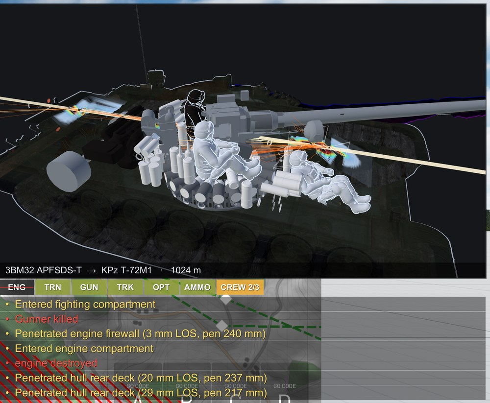

If you've played War Thunder, you know its hit camera. This is that, for GHPC, but driven by GHPC's far more detailed damage model. After every hit of yours a window opens in the corner and replays the shot: the round flying in, the plate it hits, the inside of the vehicle as it goes through, and what's left afterwards. You can make the window bigger, move it to another corner or turn it off (in the settings it's called the hit cam).

What's real in it:

- **The round.** Its path, every plate it went through, its speed and remaining penetration at each one. Those are GHPC's own numbers, recorded while the game simulates the shot.
- **The spall.** Every fragment you see is one the game simulated, on its own path. The ones that did damage are bright, the ones that hit nothing are faint (or hidden, your choice).
- **Crew and modules** change colour at the moment the game damaged them: white, yellow, orange, red, and black when destroyed or dead.
- **Fire and cook-offs.** Fires start where the game started them, and burning propellant roars out as a jet. GHPC really heats the charges until the rack goes, often 10 to 25 seconds later. Turn on **Cook-off replay** and if that happens after the replay ended while the vehicle was still in the fight, a short second replay pops up and shows you the explosion.
- **The crew** stay in their seats and change colour as they're hit. With ragdolls on (the Cinematic preset), the ones the game killed fall, pushed by the momentum of the fragments that hit them and by the blast, and they stay inside the real armour of the vehicle.

At the end you get the result (PENETRATION, CRITICAL HIT, AMMUNITION EXPLODED, CREW KNOCKED OUT...) and a list of everything that happened, in order.

By default it plays the War Thunder way: a steady camera and one constant slow motion from the round flying in to the last fragment (100x slower than real time, adjustable). If you want it more like a film, turn on **Cinematic x-ray camera** (shake, close-ups, flashes) and set **Hit cam pace** to Cinematic: it slows right down as the round goes through the first plate and speeds up again for the spall.

 

<table>
<tr>
<td>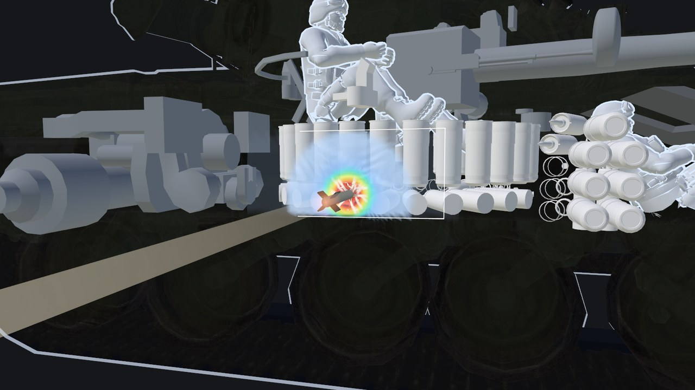</td>
<td>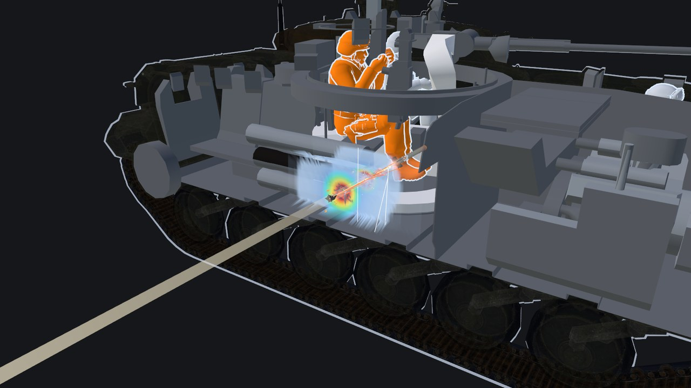</td>
</tr>
<tr>
<td>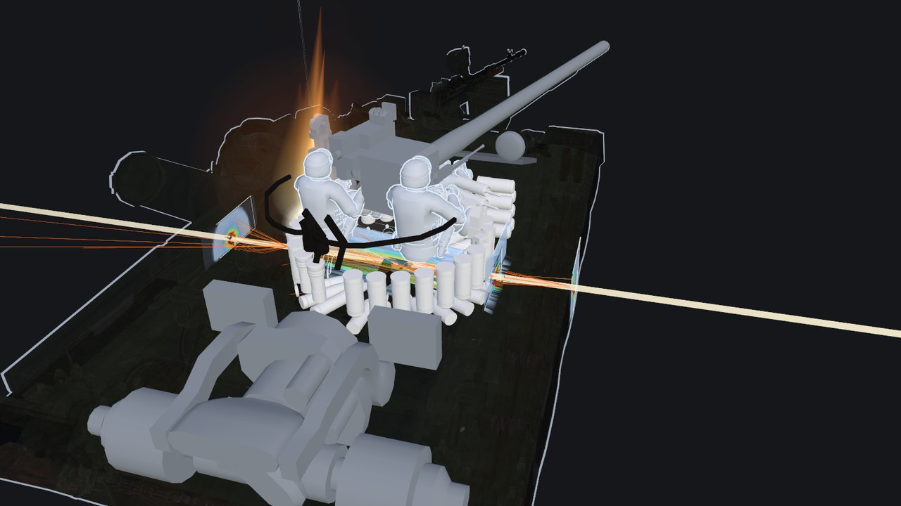</td>
<td>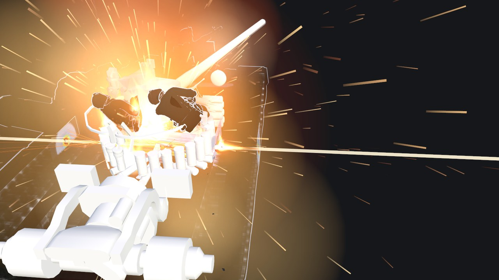</td>
</tr>
</table>

**The plate fails like a plate.** The panel you see bend isn't a decal. It's the actual armour piece the round hit, with its real outline and curvature taken from the game's armour colliders, and it fails the way that plate would at that speed, angle and thickness: thin plates tear into petals, a plug shears out, thick armour gets a crater with a raised lip, HE rips the plate open, and a round at a shallow angle digs a groove or cuts a slot. The colours are a stress map (red where the steel gives way, blue where it only bends), and it all plays out on the plate's own clock, in slow motion.

*Why I made it:* the damage model is the best part of GHPC and the game hides it. With the kill cam you learn very quickly which shots kill and why.

## APFSDS with real physics

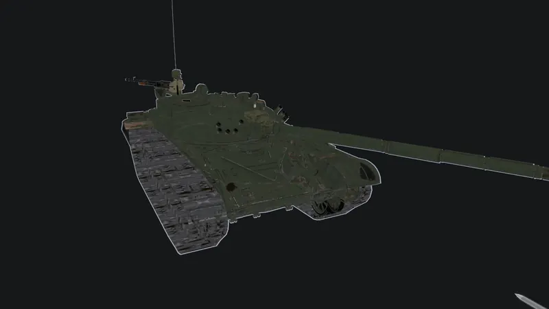
 Rod cam: 3BM32 into a T-72M1's upper glacis at 69° from 1 km. It wears down in the plate, bends 13° in the next one and snaps inside the hull, among the rounds.

Long-rod rounds get their own simulation on top of the game's. This is the part I'm proudest of.

- **It erodes.** As the rod pushes through armour it gets eaten from the front, by the Tate-Alekseevskii model (the standard way long-rod penetration is modelled), using the rod's real material: depleted uranium sharpens itself as it goes, tungsten mushrooms into a fat head, old steel rods with a carbide slug wear away fastest.
- **It bends.** Hit a plate at an angle and the rod bends in its channel, more for steeper angles and thicker plates, and you can see a wave run down it after an oblique hit.
- **It breaks.** A rod that glances off slides along the groove it dug, and if it turns too far it snaps into pieces that keep their bent shape and tumble away.
- **It matches the game.** The rod follows the game's own path, so the holes are where the game put them and the damage you see is the damage you did.

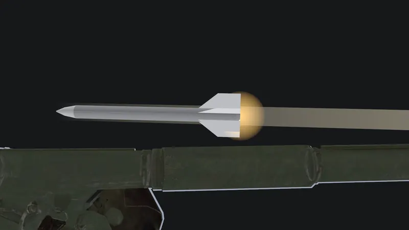
 The other way it ends: 3BM32 glances off a T-80B turret at 4°, rides its own groove for 30 cm and breaks in four.

On the proving ground you can turn on the **rod cam**: the camera rides next to the round through every plate, in deep slow motion.

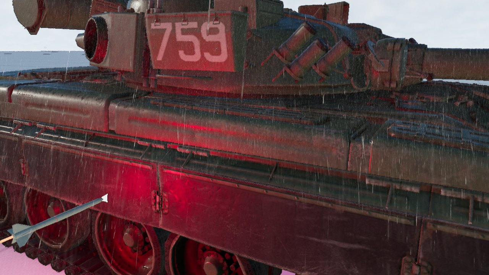

And the same kind of dart outside the kill cam: a 3BM32 a few metres before it goes into the side of a T-80B, its tracer lighting the hull red.

## Damage that stays on the vehicles

Every hit leaves real damage on the vehicle, and it stays there for the rest of the mission. The hole you see on the tank is the same hole the kill cam showed you: the same plate, the same failure (petals, plug, crater, groove), worked out the same way from that exact hit, at the exact spot the game's round went in.

- Holes the size of the round, petals bent the way it was travelling, exit holes bulging outward, grooves where rounds glanced off, scorch and sparks. The torn edges glow and cool down to black.
- Gun barrels bend or snap off, depending on how much steel is left around the hole (a bent gun still works).
- When the game destroys a track (a round on it, or a blast beside it), the real track breaks into links and falls off the wheels.
- Destroyed engines burn through the engine deck. A helicopter's tail boom is a real thin-skinned tube: HE tears its skin, and once the game brings the helicopter down the boom snaps where it's weakest and falls off with the tail rotor.
- While ammo burns inside, flames shoot out of the holes your rounds made, as far as the pressure inside pushes them.
- Where a turret has been thrown off, you look down at the burnt rack under the ring, not through the hull at the ground behind it.

<table>
<tr>
<td>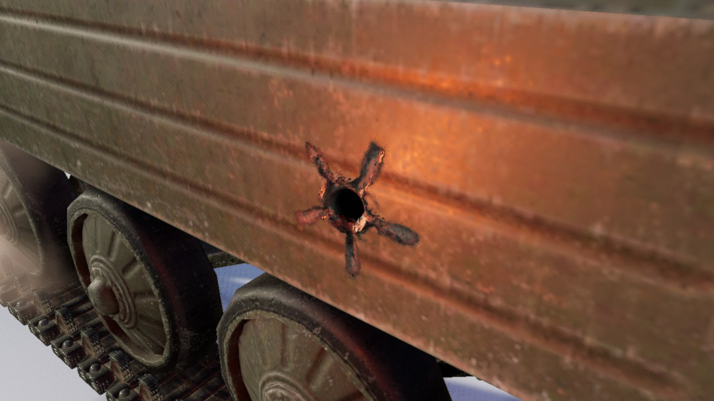 Light armour: a dart through a BMP-2's side, the petals bent inward the way it went.</td>
<td>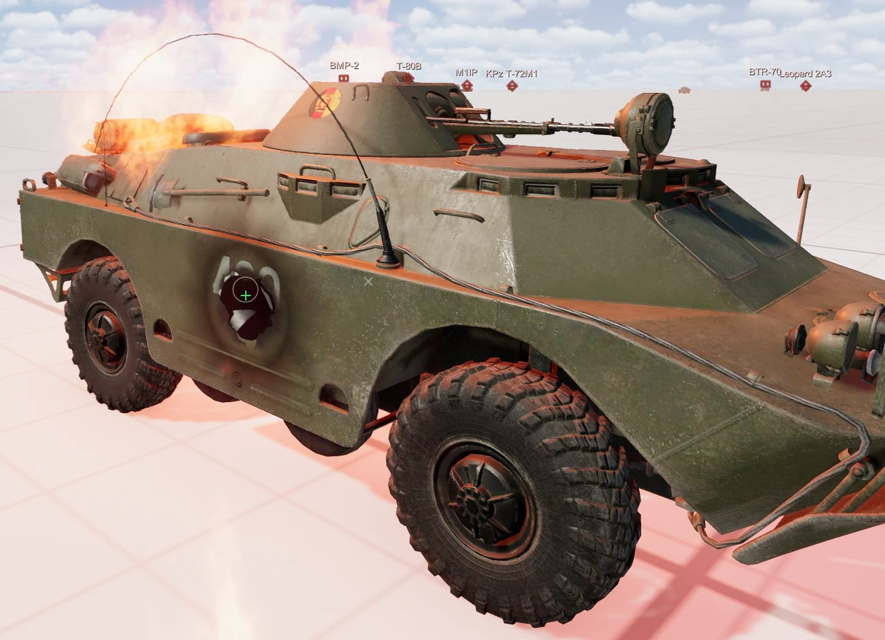 HE on a BRDM-2's side: the thin plate torn open, the paint scorched round it.</td>
</tr>
<tr>
<td>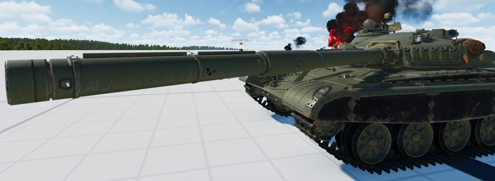 Every round that hits the gun leaves its own hole in the barrel.</td>
<td>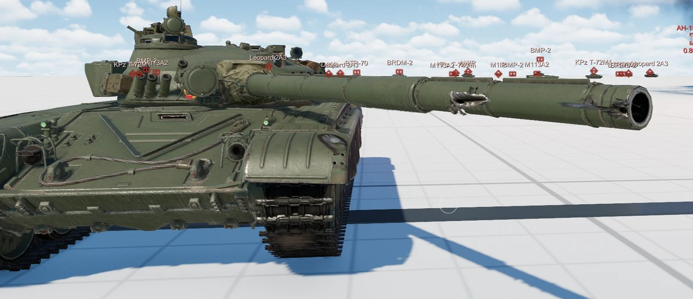 A barrel torn open in the middle and gouged by the muzzle. With too little steel left it bends or snaps.</td>
</tr>
<tr>
<td>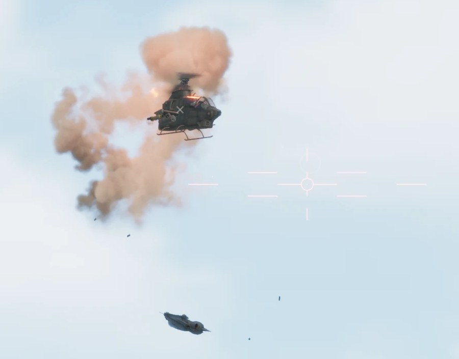 HE in an AH-1's tail: the boom tears off and falls away with the tail rotor.</td>
<td>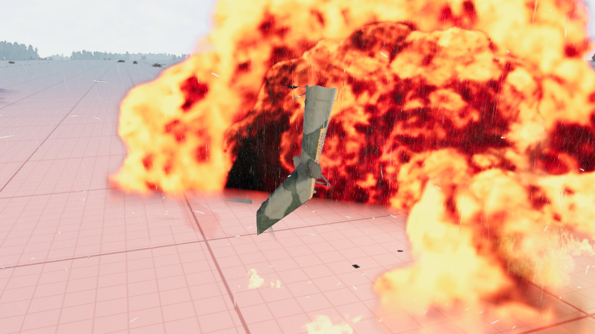 A 152 mm HE shell tore a Mi-24's tail boom open; as it came down, the boom broke off.</td>
</tr>
<tr>
<td>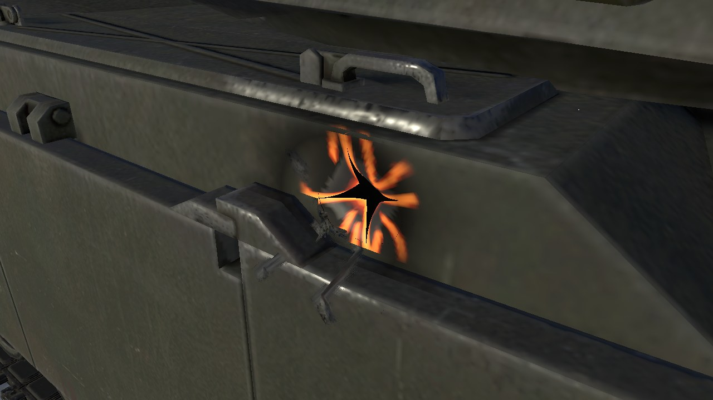 A fresh hole in an M1IP's sponson, its edges still glowing.</td>
<td>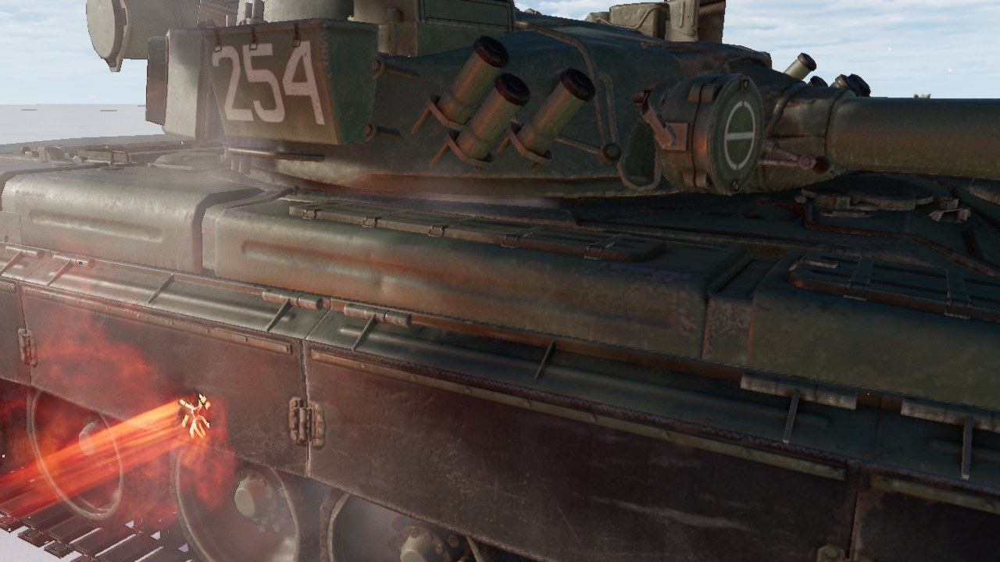 The charges burning inside: flame forced out through the hole the round made.</td>
</tr>
</table>

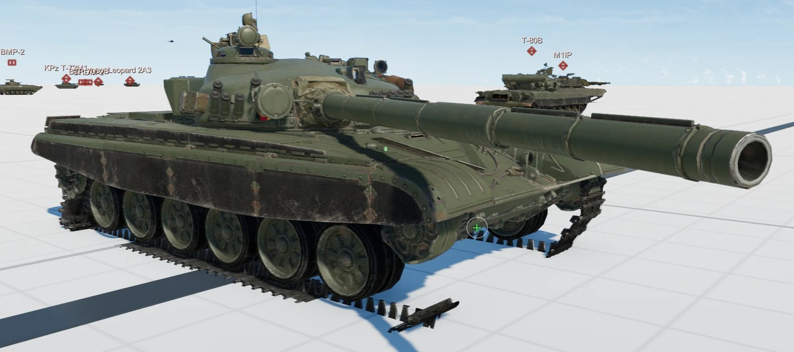

A T-72M1 after hits on both tracks from the front: the near one came off the wheels and lies on the ground, the far one hangs from the idler.

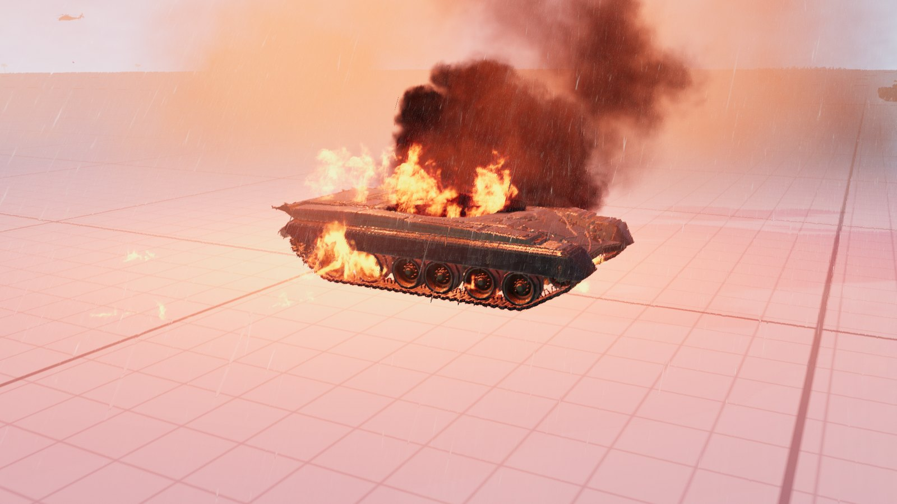

A T-80B eighteen seconds after a 3BM32 went into its side: the rack went and took the turret with it.

It's all visual, so it never changes what the game decides. (There's one optional exception, below.)

*Why:* a knocked-out tank should look like something happened to it. Now you can drive past a wreck and read the fight from the holes.

## Explosions that sound like it

GHPC plays roughly the same sound for a small HE shell and a whole ammo rack going up, and they barely get quieter with distance. Here every explosion is scaled by the size of its charge, using real blast physics, and it reaches you at the speed of sound: you see the flash first and hear it a moment later, more the further away you are.

A tank blowing its turret off is a huge boom that carries for kilometres. A rack going off with the turret still on is a solid boom, and the rounds cooking off after it are much quieter and barely shake the view ("Later ammo blasts" in the settings: 0 mutes them). Close up it's one hard bang; far away you hear it roll off the terrain. The blast wave also gives your view a short kick ("Shockwave shake" in the settings turns it off). The kill cam grades them the same way: only the blast that throws the turret fills the whole hull with fire.

**One optional change to the game itself:** when an ammo rack goes off inside a vehicle, the crew near it die. GHPC sometimes leaves a crewman unhurt after a 13 kg detonation right next to him. It's on by default and you can turn it off.

## War Thunder style HUD

Sometimes I want GHPC to feel a bit more arcade, so there's an optional HUD inspired by War Thunder. Every part can be switched on and off on its own, and H turns the whole thing off at once.

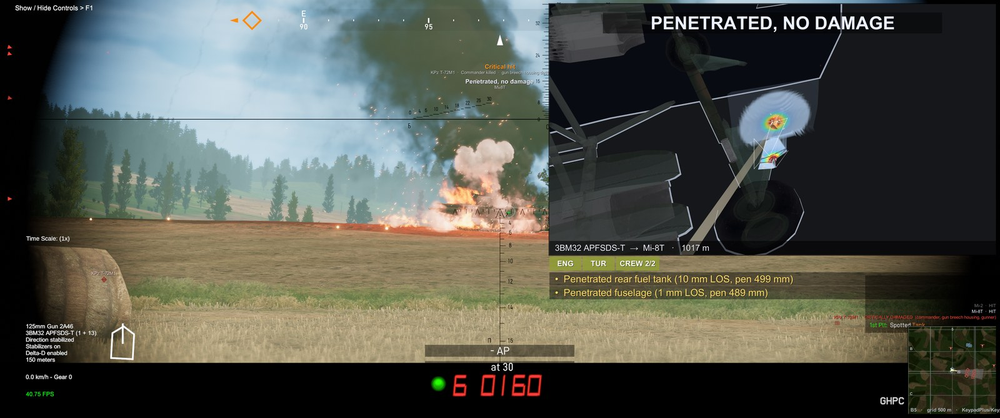

- **Hit callouts** after each shot: PENETRATION, CRITICAL HIT, and what you damaged.
- **Kill feed**, with the kill credited to you when a target burns out or cooks off later.
- **Pen indicator** on your impact point: green goes through, yellow maybe, red doesn't, blue bounces. It's worked out from the game's own armour along the round's path and your round's penetration at that range, so it's not a guess.
- **Impact cross** that shows where your round will actually land, with the game's own ballistics.
- **Markers** on enemies your side has spotted, and a lead circle on helicopters.
- **Minimap** with class icons and objectives.
- **Hit and kill sounds** (made by the mod, so you can swap in your own).

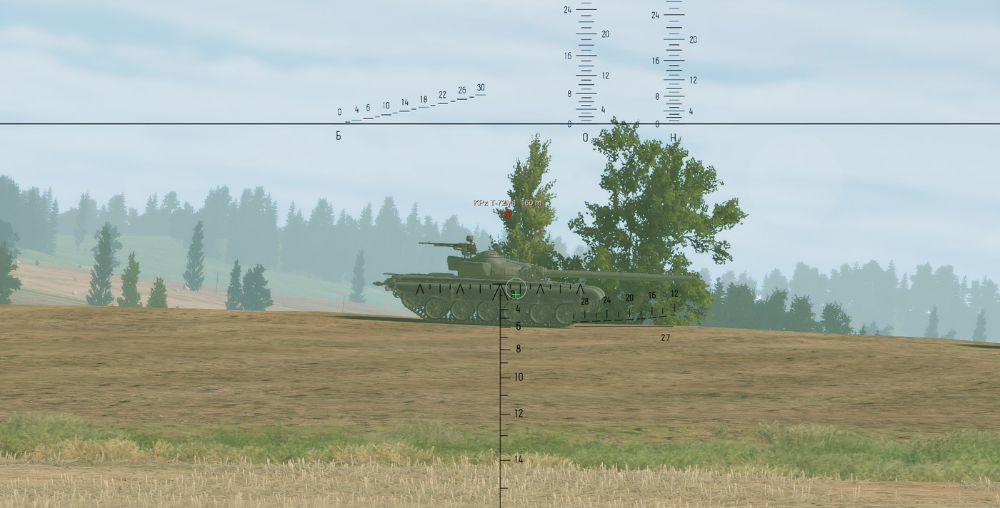

## Proving ground

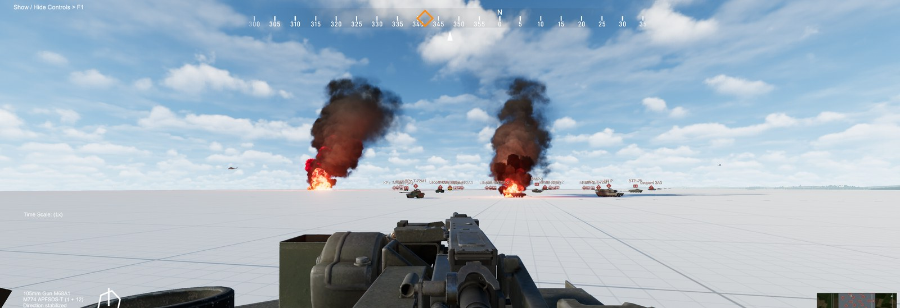

Testing rounds in a normal mission was a pain: find a target, get to the right range, hope the AI doesn't drive off or shoot back. So I built a proving ground, like the VR range in Arma 3 or War Thunder's test drive.

Click **PROVING GROUND** in the main menu (you can tell the modded game by the red COMBAT OVERHAUL under the title). It loads the game's M1 Abrams training range, which is almost empty, and builds a huge flat grid floating above it, far from everything. Only the grid and the vehicles on it are drawn, not the map underneath, so it looks like a VR range and runs a lot faster ("Empty map" in the settings brings the map back). Rows of real enemy vehicles stand every 100 m out to 500 m (T-72M1, T-80B, M1IP, Leopard 2A3, BMP-2, BTR-70, M113 and BRDM-2), some facing you, some side-on, some at three-quarters, two tanks wait further out at 1 km and 1.5 km for long shots, and two helicopters hover at 400 and 500 m. Off to the left, clear of the rows, stand soft targets from 120 to 380 m: jeeps (UAZ-469, M151) and trucks (Ural 375D, M923), for the HE and the machine guns. Their AI is switched off, so they just sit there and take it, engines idling. The ranges are painted on the deck and on boards you can read through the sight. Want more rows? "Proving ground rows" in the settings, each row costs a little frame rate.

Knock a target out (destroyed, its crew dead, or bailed out after your hit) and it comes back by itself 20 seconds later. Change the time or turn it off with "Targets come back after" in the settings.

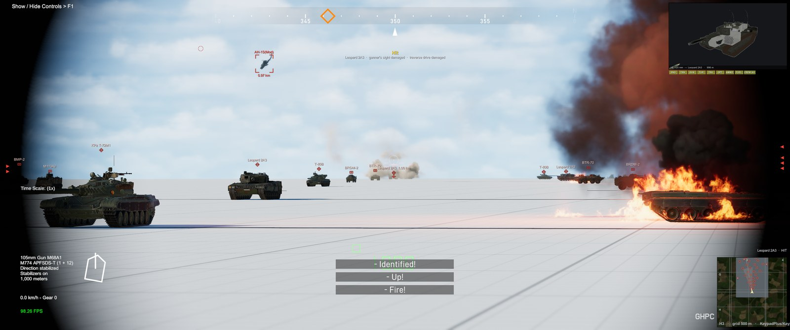

You start in your vehicle on the firing line, with the vehicle list open in case you want another one, and a short briefing on the keys. **Home** opens the tools:

- **You.** Pick your vehicle from every ground vehicle in the game (tanks, IFVs, APCs, scout cars, trucks, jeeps) and where you start: on the firing line or anywhere down range, facing either way.
- **Targets.** Respawn the ones you've wrecked, or all of them, and place your own: any vehicle, at any range out to 2 km, left or right, facing you, side-on, three-quarter or away.
- **Shot lab.** Pick any round in the game, any target, the direction (front, side, rear, top, three-quarter, or exact angles), the part to hit (hull, turret, lower hull, turret ring) and the range, from 0 to 4 km. The round arrives with the speed and penetration it would have at that range. Bombs fall straight onto the target, as dropped from 300 m.
- **Rod cam** and a bigger kill cam window for close-ups.

Building it takes a little while (about 20 s, a note on screen counts it). Restart Mission brings the proving ground back as you left it: your vehicle, where you started and the targets you placed. Tab only lists your own vehicle there; change it in the tools.

You can also build one inside any mission with **Alt+Home**.

## Armor Sim

<table>
<tr>
<td>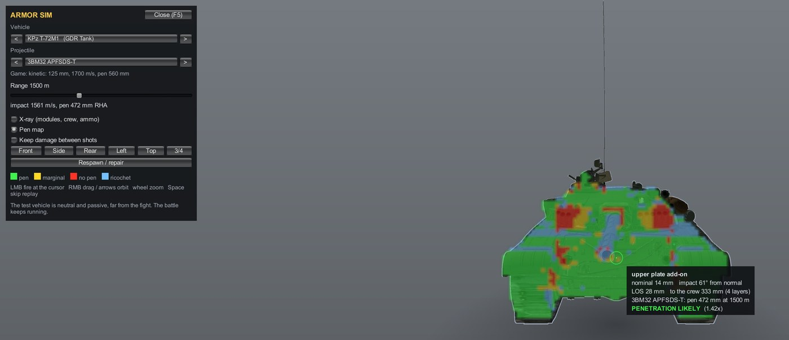</td>
<td>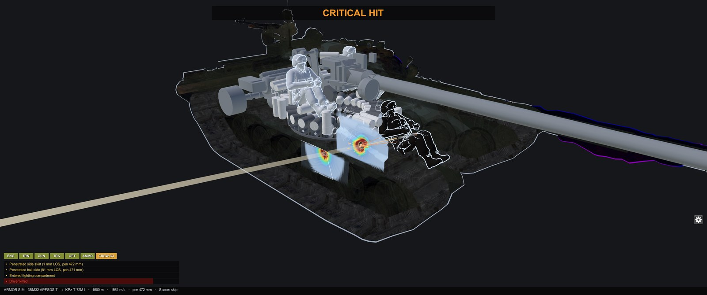</td>
</tr>
</table>

The protection analysis from War Thunder, for GHPC, made only from the game's own armour data. Pick any of the game's 73 ground vehicles and any round at any range, and the vehicle is coloured by where that round gets through (green), might (yellow), doesn't (red) or bounces off (blue). Point at a spot to see the plate, its thickness, the impact angle and all the armour along that line. Click to actually fire the round there and watch the hit in a full-screen kill cam.

Open it from the main menu (**ARMOR SIM**, it loads the same quiet training range) or with **Insert** in a mission. It starts on the M1IP. Drag with the right mouse button to turn around the vehicle, with the middle one to move the view (double-click to centre it again), and scroll to zoom.

## After Action Report

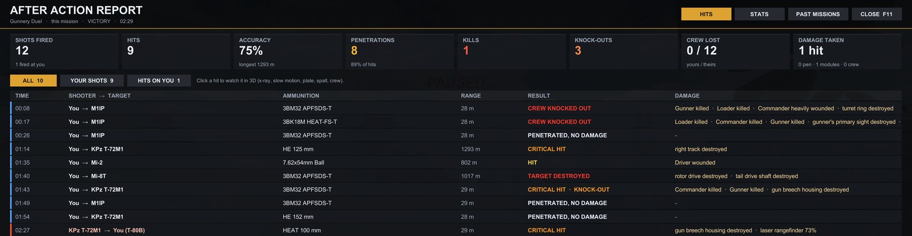

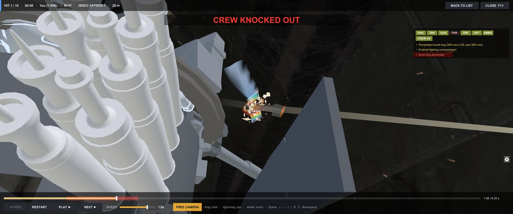

Press **F2** during or after a mission.

GHPC has its own AAR when a mission is over, and it's good at something else: the whole battle, shot by shot, frozen at the moment of each hit. This report replays your hits in motion, and you can open it while you play. They go well together:

| | GHPC's own AAR | This mod's report |
|---|---|---|
| When | after the mission | any time, during or after (it pauses the game), and from the main menu |
| Which shots | every shot of the battle, anyone's, hits and misses (filters: yours only, hits only, small calibre, fire support) | your hits, and every round that hit your vehicle |
| Each shot | the battlefield frozen at the moment of the hit, every unit where it was, the round's path and every spall path in 3D, an x-ray view, the blast sphere of HE | a slow-motion 3D replay of the hit itself: the round, the plate failing, every spall fragment, modules changing colour, crew falling, fires, the cook-off |
| What it tells you | shooter, target, range, round, time, and the game's own story of the shot: every plate with its thickness and the penetration left, what was hit | the same story with more in it (below), and a verdict for each hit: penetration, crew knocked out, ammunition fire, destroyed |
| Camera | orbit, ride along the round's path, jump to the shooter | free orbit, 0.1x to 2x speed, a timeline you can scrub |
| Stats | mission results: winner, crews and vehicles lost on each side, shots fired, lethality, time | yours: shots, hits, accuracy, penetrations, kills, crews knocked out, per round type, per target, your losses and the damage you took |
| Earlier missions | | kept and replayable if you choose (none by default) |

How detailed each hit is in this report: every plate the round went through (its name, the line-of-sight thickness, the angle, how much penetration the round still had), every spall fragment and what it hit, each module's health before and after, each crewman's wounds by body part and his state (wounded, critical, killed), fires and where they started, ammunition catching fire and racks going off, and when each of those happened.

## Tools and quality of life

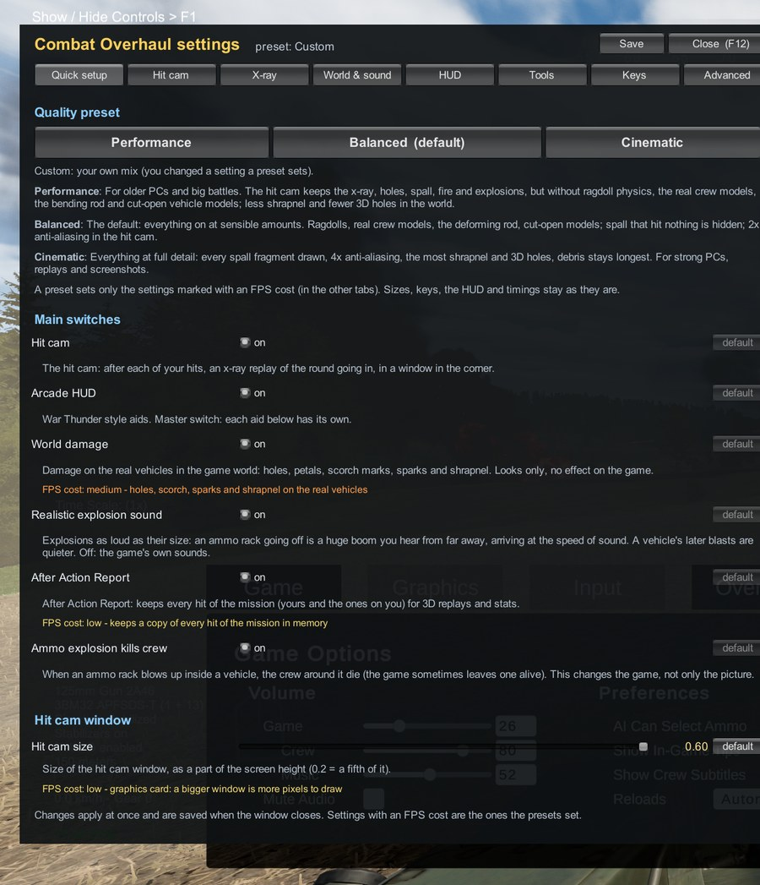

- **Settings window** (F12) with three presets and a short line on what every option does. The options that cost frame rate say how much and why. It's also in the game's own Options as an **Overhaul** tab.
- **What's new and updates.** The main menu shows what changed in each version, and tells you when a new one is out: one click installs it, then the game offers to restart. It checks this project's GitHub releases once per start; set "Check for updates" to Auto, Ask or Off.
- **Arsenal** (U): your main gun fires any round in the game, including generated shells from 20 to 203 mm and bombs (a bomb falls from 300 m onto whatever your sight is on). Perfect for "what if".
- **Test range** (Alt+K): drops targets and circling helicopters around you in any mission.
- **Debug log** with a frame profiler, for when something goes wrong.

 

## The physics behind it

No made-up numbers. The damage itself (penetration, armour, spall, which modules and crew get hit) is GHPC's own simulation, recorded as the game runs your shot. Everything the mod adds on top of that is built on published physics, not on numbers picked to look good:

| What | Model | Source |
|---|---|---|
| A long rod wearing down as it pushes through armour | Tate-Alekseevskii penetration, with target strength | A. Tate, *A theory for the deceleration of long rods after impact* (1967); V. P. Alekseevskii, *Penetration of a rod into a target at high velocity* (1966); RHA strength values from C. E. Anderson Jr. et al. |
| How a struck plate fails (petals, plug, dishing, crater, groove) | the classic failure modes of perforation | M. E. Backman, W. Goldsmith, *The mechanics of penetration of projectiles into targets* (1978) |
| How strong a blast is at a distance, how loud it is and how far it carries | Kingery-Bulmash airblast curves, Hopkinson-Cranz cube-root scaling | C. N. Kingery, G. Bulmash, *Airblast Parameters from TNT Spherical Air Burst and Hemispherical Surface Burst* (1984), simplified by M. M. Swisdak (1994) |
| How fast a shell case's fragments fly | Gurney equations | R. W. Gurney, *The Initial Velocities of Fragments from Bombs, Shells and Grenades* (1943) |

And the extra layers never overrule the game: if GHPC says the round bounced, the kill cam shows a bounce. (The one optional exception is "Ammo explosion kills crew", above.) Automated tests fire known rounds at known targets and angles and check that it all lines up with what the game reports.

## Performance

It does a lot, so I spent a good while making it light. The heavy work (copying the vehicle when you hit it, building the x-ray crew, cutting holes into meshes, preparing the physics) runs on background threads or gets done ahead: every vehicle in the mission is looked over in the background once, so when your round hits, the mod already knows what to copy, and the vehicle in your sight even has its crew models ready. The kill cam itself is then put together over a few frames instead of one. On my PC opening the kill cam went from about half a second of freeze to a few frames of 15-35 ms that you don't feel.

If your PC struggles, pick the **Performance** preset in the settings.

| | Performance | Balanced (default) | Cinematic |
|---|---|---|---|
| Crew ragdolls, burning crew thrashing | off | off | on |
| Second replay when the ammo cooks off later | off | off | on |
| Real crew models | off | on | on |
| Bending, breaking rods | off | on | on |
| Holes cut into the models | off | on | on |
| Spall that hit nothing | hidden | hidden | shown |
| Kill cam anti-aliasing | off | 2x | 4x |
| Shrapnel on the ground | off | up to 120 pieces | up to 220 pieces |
| 3D holes kept on vehicles | 12 | 24 | 48 |

What it costs, measured on my PC (RTX 5080, Ryzen 7 7800X3D, 3440x1440) on the proving ground, with the default calm kill cam. To leave the game's own explosions, fire and smoke out of it, one recorded hit (3BM32 into a T-72M1's side: a fire, crew hit, the rack going off) was replayed again and again with each preset and setting, so the numbers are only what the kill cam adds while it plays:

| Preset | without the kill cam | while it plays | the kill cam adds |
|---|---|---|---|
| Performance | 131 fps | 87 fps | about 3.8 ms a frame |
| Balanced | 130 fps | 84 fps | about 4.2 ms a frame |
| Cinematic | 130 fps | 77 fps | about 5.2 ms a frame |

The milliseconds are what carries over to your PC: at 100 fps, 4.2 ms more is about 70 fps while the kill cam plays, 5.2 ms about 66. When it closes you're back where you were.

Single settings, each changed on its own from Balanced:

| Setting | while the kill cam plays |
|---|---|
| Ragdolls and physics on (as in Cinematic) | about 0.3 ms a frame more |
| Anti-aliasing 8x instead of 2x | 1 to 3 ms more |
| Anti-aliasing off | under 0.5 ms less |
| Every spall fragment drawn | under 0.5 ms more |
| Real crew models, bending rod, cut-open models | no difference I could measure (their work is done when the round hits, off the main thread) |
| Cinematic pace instead of Constant | about 2 ms less on average, but the replay lasts longer |

The moment of the hit itself is one frame of 40 to 140 ms on my PC, the game's own explosion included. The damage left on the vehicles afterwards (holes, flames out of them, broken tracks) costs under 0.5 ms a frame.

---

## Settings and presets

Press **F12** in game or open the **Overhaul** tab in the game's Options. The **Quick setup** tab has the presets:

- **Performance:** the kill cam without real crew models, bending rods and cut-open models, and less shrapnel. For older PCs and big battles.
- **Balanced** (default): calm, the War Thunder way. Real crew models that stay in their seats, the bending rod, cut-open models.
- **Cinematic:** everything at full detail, crew ragdolls and cook-off replays included. For strong PCs, replays and screenshots.

A preset only changes the settings marked with an FPS cost. Your sizes, keys and HUD choices stay as they are. The look of the kill cam is up to you too: **Cinematic x-ray camera** (shake, close-ups, flashes) and **Hit cam pace** are in the Hit cam tab, both off / Constant by default.

Coming from 1.0.0 with the settings untouched? They move to the new calmer defaults by themselves. Anything you had changed yourself stays.

## Keys

| Key | |
|---|---|
| F12 | Settings |
| F9 | Kill cam on / off |
| F10 | Replay your last hit |
| F2 | After Action Report |
| H | Arcade HUD on / off |
| Insert | Armor Sim |
| Home | Proving ground tools (on the proving ground) |
| Alt+Home | Build a proving ground in the mission you're in |
| Alt+K | Test range (spawns targets around you) |
| U | Arsenal (9 and 0 pick a round, J fires it at once) |
| Num * / Num / | Minimap zoom in / out |

None of them are keys the game uses itself, and the ones that change the mission you're in need Alt, so you won't hit them by accident. They do nothing while the game's own After Action Report is open. Change any of them in the settings' **Keys** tab: click it and press the new key, with Alt, Ctrl or Shift if you like, or set it to none. The tab tells you if the game (or another of these) already uses a key. Coming from 1.0.0, your keys move to these by themselves, unless you had set your own.

## Good to know

- Single player only, like the game.
- The kill cam needs a moment to copy the vehicle when your round hits. On a slow PC you may feel a short hitch on hits; the Performance preset makes it smaller.
- Nothing is written to disk by default: the report shows the mission you're in and the one before it from memory. To look at older missions, set "Past missions kept" in the Tools tab; their hits then go to `Bin\UserData\HitCam`, and anything older than that is deleted when you close the report or start a mission.
- Tested together with Gunner Mod PC, Fulda Expansion Pack and Pact Increased Lethality, and on the plain game. The vehicles the proving ground and the Armor Sim spawn get those mods' conversions too (a Leopard 2K comes as one of its variants, a T-80B as a T-80U if you set PIL up for it), the vehicle lists tag them ("[PIL > T-80U]"), and the kill cam sees their ERA and armour. Other vehicle mods built the same way should work too; if one doesn't, tell me. On the proving ground the modded targets' ERA bricks share their materials: every brick had its own copy (a modded range has about 1900 bricks on 800+ copies), so each was its own draw call, and sharing the identical ones is about 45 fps on my PC with the same picture.
- Found a bug? Turn on "Debug log" in the Advanced tab, play until it happens, and open an issue with `Bin\MelonLoader\Latest.log` attached.

## Current limitations

- **Single player only**, like the game.
- **A short hitch on hits on slow PCs.** The kill cam copies the vehicle the moment your round hits. Most of the work is done ahead or in the background, but some has to happen in that frame. The Performance preset makes it smaller.
- **See-through holes only where the model allows it.** Some of the game's models can be cut open, others can't. Where they can't, the 3D hole is drawn on the hull, so it looks the same from outside but you can't see through it.
- **No full interiors.** GHPC's vehicles don't have modelled interiors, so an opened hull shows the game's own x-ray models of what's inside (seats, breech, engine and so on), not a detailed crew compartment.
- **Ragdolls, not gore.** With ragdolls on, crew the game kills fall as ragdolls in the kill cam. There's no dismemberment.
- **The world damage is visual.** It's worked out from the real hit, but it doesn't feed back into the game's damage model (except the optional "Ammo explosion kills crew").
- **Kept past missions replay on a simple model.** The game's meshes can't be saved, so hits from older missions (if you keep them) replay on a box model of the vehicle. Everything that happens is the same, it just looks plainer.
- **Autocannons get a lighter kill cam.** A 20-30 mm burst plays the War Thunder way: one x-ray for the whole burst, the camera holding still and every round arriving into it, with simple holes instead of the deforming plates (a full replay for every round of a burst costs a lot of frames on any PC). You can turn that off ("Light hit cam for autocannons"), at your own frame rate's risk.
- **Tested on GHPC build 20261014 with MelonLoader 0.7.1.** A game update can break parts of it until the mod is updated.

## Credits

Thanks to Radian Simulations for a tank game this detailed under the hood. No game files are included: everything the mod shows or plays is either made by the mod or loaded from your own copy of the game. This mod isn't affiliated with Radian Simulations.

## License

The mod's code is under the [MIT License](LICENSE): use it, change it, learn from it, build on it. *Gunner, HEAT, PC!* and everything in it belong to Radian Simulations.
