**English** · [Русский](README.ru.md) · [简体中文](README.zh-CN.md)

# GHPC Combat Overhaul

**See what your round actually did.**

Shot cam, x-ray hit cam, death cam, a new HUD and every menu redone, for *Gunner, HEAT, PC!*

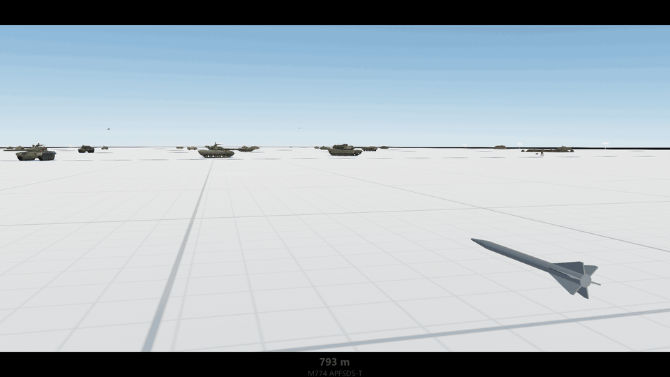

**[Download](../../releases/latest)** · [Install](#install) · [What's in it](#whats-in-it) · [Settings](#settings) · [Keys](#keys)

**[Join the unofficial GHPC modding Discord](https://discord.gg/BW2sgyCht7)**: updates, WIPs, other mod releases, and a place to chat with modders and the whole community.

---

GHPC has the most detailed damage model I've seen in a tank game, and you almost never get to see it. You fire, the target stops, that's it.

So I started with an x-ray cam with one rule: nothing in it is made up. The mod records what the game simulated on your shot and replays exactly that. Then I kept adding what I missed while playing. 2.0 is where it reaches the rest of the game: the HUD, the menus, the map, the end of a mission.

Every part can be switched off on its own. On the first start you pick how you want to play (Arcade, Realistic or Close to vanilla) and a look, and the mod sets itself up.

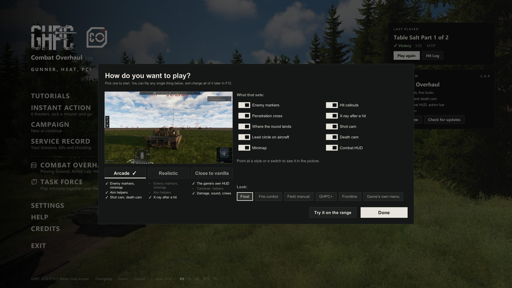

## Install

Reccomended way is to use GHPC Mod Manager - by partnering with it's dev some of my mods features will be slowly linked to it (like custom missions downloader/repo etc.)

You can get Mod Manager [HERE](https://github.com/RoyZ-iwnl/GHPC-Mod-Manager)

____________________

Manual installation: 

**You need:** *Gunner, HEAT, PC!* build 20261014 and MelonLoader 0.7.x.

1. Install MelonLoader with the [MelonLoader installer](https://github.com/LavaGang/MelonLoader.Installer). Point it at `steamapps\common\Gunner HEAT PC\Bin\GHPC.exe` if it doesn't find the game.
2. Start the game once and close it.
3. Download `GHPCCombatOverhaul.dll` from [Releases](../../releases/latest) and put it in `Bin\Mods`.
4. Start the game.

**Updating:** the main menu offers the new version by itself via GitHub API. With Mod Manager, press Update. If the in-game update fails, download `GHPCCombatOverhaul.dll` from the release page and put it over the old one in `Bin\Mods`. The updater in 1.2.x stops after 90 seconds, so on a slow connection the download by hand is the way.

**Uninstall:** delete `Mods\GHPCCombatOverhaul.dll`. See [Files it writes](#files-it-writes) for what's left.

## What's in it

### Shot cam

Follow your round from the gun to the target in slow motion, then the camera glides straight into the x-ray of what it did inside, no freeze frame. It stays off until you press V, and V switches it on and off. Space skips one. How often it plays, for which weapons and from what range is up to you, and "When it plays" can keep it for the last enemy or for your V key only (Settings > Cameras > Shot cam).

### Hit cam

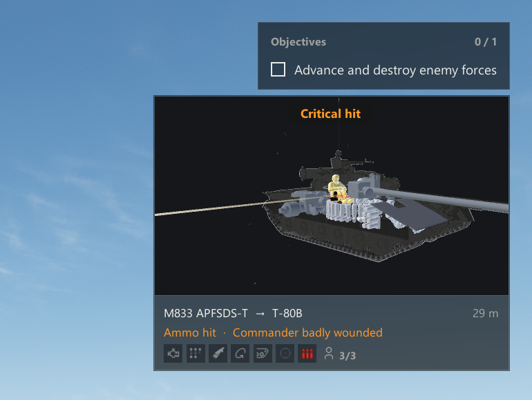

The small x-ray window in the corner after your hits, similar to War Thunder hits. The round, the plate it hits, every spall fragment, the crew and modules changing colour as the game damages them, fires and the rack cooking off. Under it, a row of what state the target is in now. All of it is the game's own simulation of that shot, recorded and replayed.

APFSDS rods get their own physics on top: they erode, bend and snap by material (Tate-Alekseevskii), and still follow the game's path, so the hole is where the game put it.

### Death cam

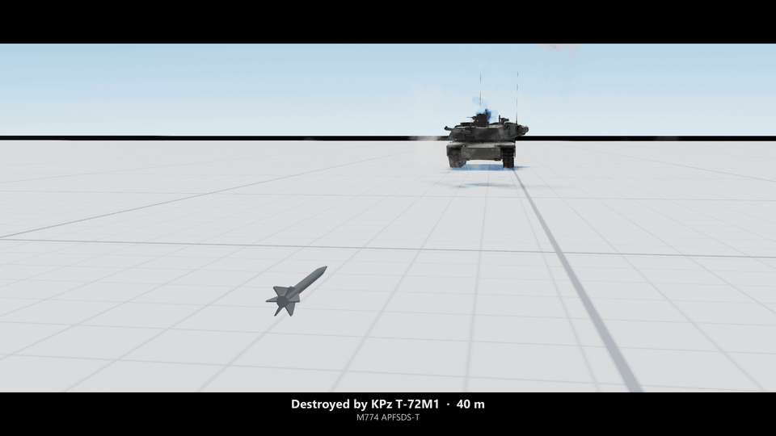

When you're knocked out: the round that got you, flown from their gun into your tank, the x-ray of what it did, then the view from behind the gun that fired it. Any key skips it.

### Combat HUD

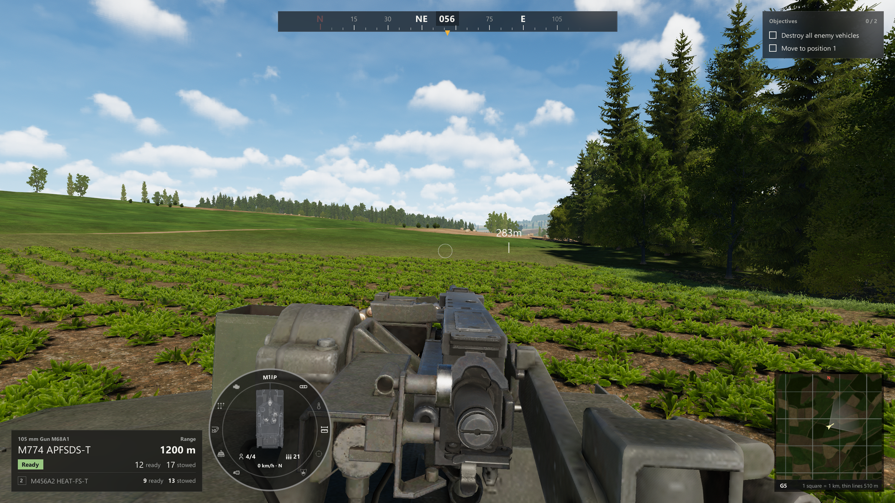

Your gun, rounds and reload, your crew as icons, and modules that only show when something breaks. A compass strip and a minimap, both with waypoints. Markers on spotted enemies, friendlies in blue with name and distance. Their labels are War Thunder style: plain coloured text, no box. A pen indicator from the game's own armour and an impact cross from the game's own ballistics.

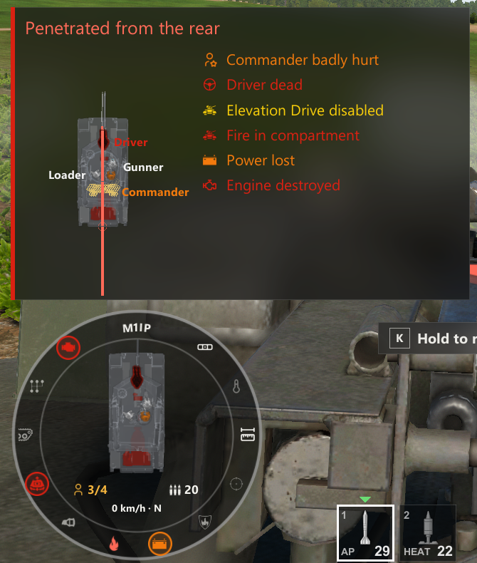

Get penetrated and a damage panel traces the hit on a top-down drawing of your own tank.

Alt+H opens the HUD editor: pick the look, switch parts on and off, move and resize them. H turns the aiming aids (markers, pen indicator, impact cross) on and off. You can keep the game's own HUD too.

### Five looks

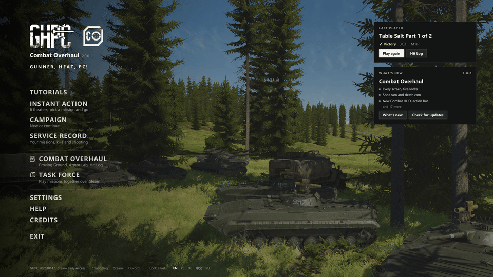

Frost, Fire control, Field manual, GHPC+ and Frontline. Each one lays out the main menu, Instant Action, the settings, the map, the service record and the end of a mission its own way, down to the scrollbars. Frontline also adds an action bar: rounds, reload, smoke and repair in one row.

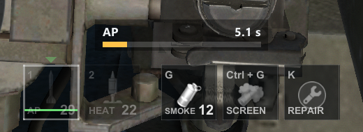

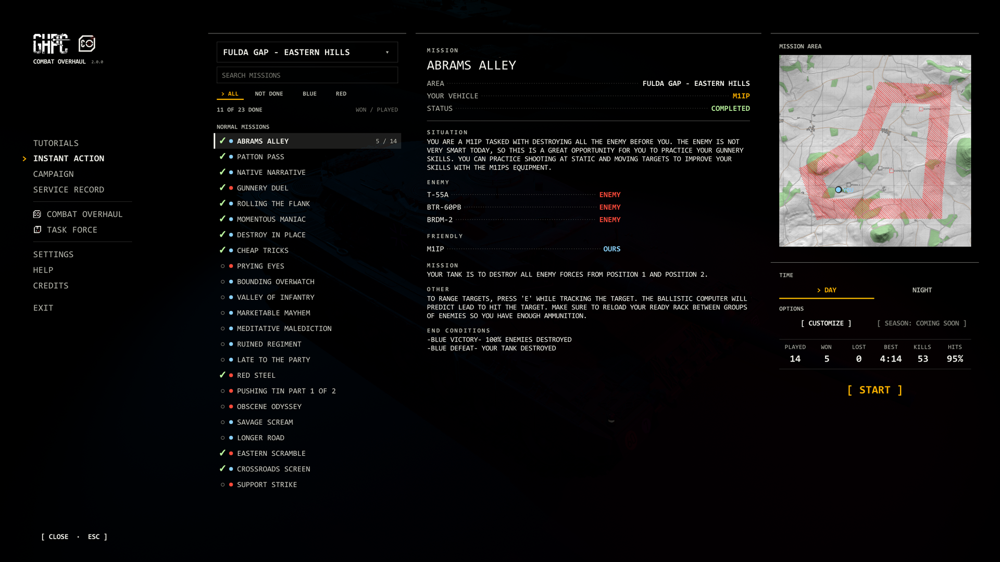

- **Main menu:** your last mission with Play again and its Hit Log, what's new, and the mods you run.
- **Instant Action** on one page: every mission with your won / played, search, the briefing, photos of the vehicles in it, a map of its area, side, time and Start.
- **Service record:** missions, kills by kind, longest kill, hit rate, fire support you called, your losses.
- **The map:** objectives in one column (click one and the map jumps there), briefing, legend, fire support and go codes as panels that slide out.
- **Mission over:** a banner with how it went, then the results in your look.

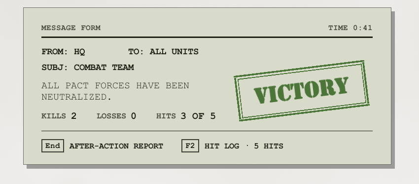

### Damage that stays

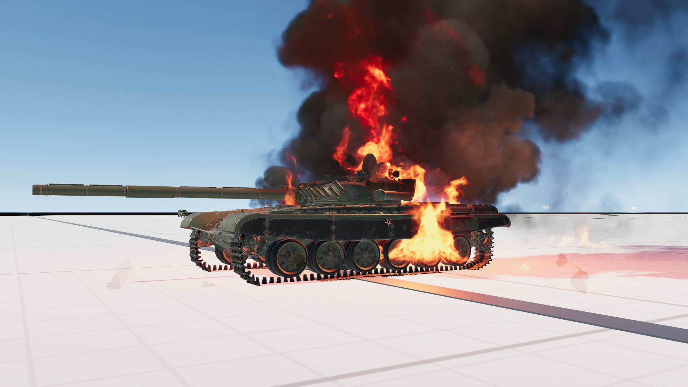

Real holes, petals and grooves where the rounds went in, holed and torn barrels, tracks that break and fall off, burning engines, flames out of the holes. It's visual and never changes what the game decides. AI hits on each other far from you (over 300 m) get lighter marks, to save frames. Explosions are scaled to their real charge and reach you at the speed of sound.

One optional change to the game itself: an ammo rack going off inside a vehicle kills the crew near it (on by default).

### Hit Log

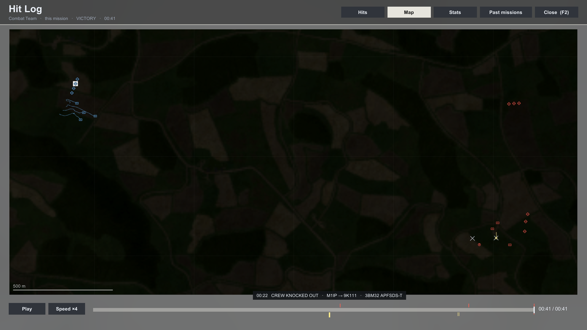

Press F2 during or after a mission. Every hit of yours and every one on you, replayed in 3D with a free camera. And the whole mission from above on a timeline: everyone's moves, every hit as a line from shooter to target. Click a hit for its replay.

### Armor Lab

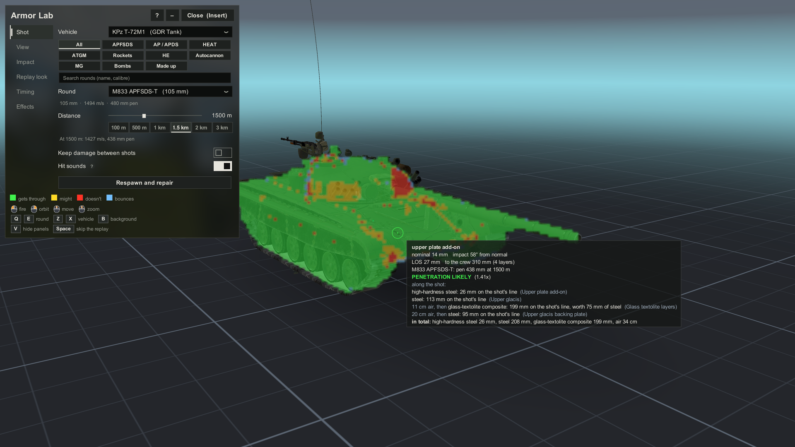

Any vehicle, any round, any range: the vehicle coloured by where that round gets through, from the game's own armour data. Click a spot to fire the round there and watch it. Main menu, or Insert in a mission.

### Proving Ground

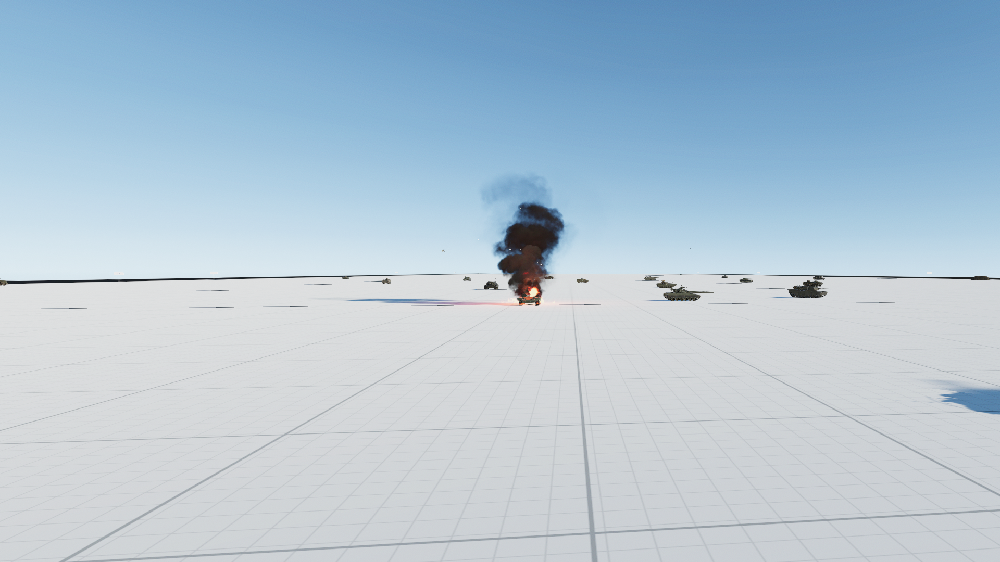

A range from the main menu: targets every 100 m, any vehicle as yours, your own targets, and a shot lab for any round at any angle and range. Knocked-out targets come back by themselves.

### Smaller things that are still nice to have
- Service record! See your stats, hits, deaths, time played, records and many more! available in main menu. (WIP level system for multiplayer)
- Field repair on K. (can be disabled - finally broken engine, track, or other module won't stop you from fighting on! Do note crew needs to get out of the tank to repair the module...)
- Picture & effects in the pause menu: colour looks and sliders, PostFX etc.
- The Arsenal (U) on the Proving Ground and in the Armor Lab: your gun fires any round in the game.
- Vehicle photos in the briefing: hover an underlined name.
- Reworked instant missions menu, see the map area, vehicle photos, filter by any mission
- Mod is translated to English, Polish, German, Russian and Chinese.
- I actually dont know what else to add here because there's so many nice little things I've added since first release. I guess you'll have to see for yourself :)

## Settings

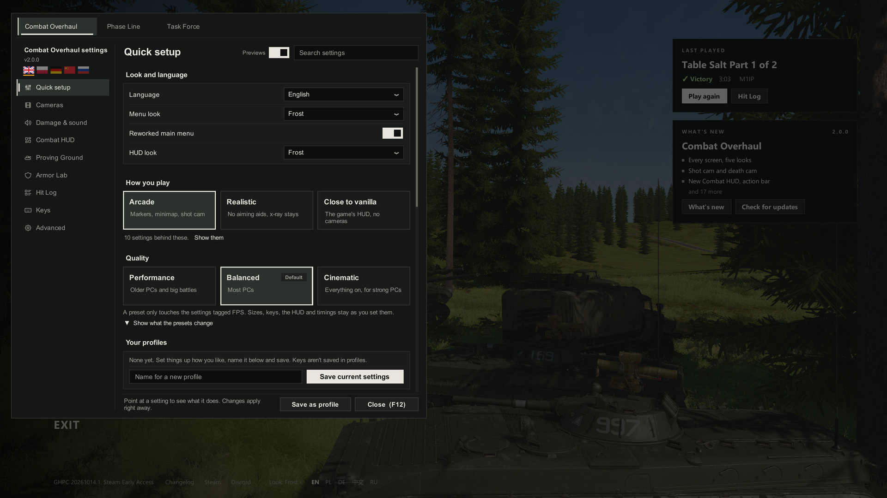

Press **F12**, in the menu or in a mission. It's also in the game's own Options as the Overhaul tab.

Quick setup has your playstyle, the look, the language, the quality presets (Performance, Balanced, Cinematic) and the update check. The other pages: Cameras, Damage & sound, Combat HUD, Proving Ground, Armor Lab, Hit Log, Keys, Advanced. Every option has a line on what it does, and the ones that cost frame rate say so.

## Keys

| Key | |
|---|---|
| F12 | Settings |
| Alt+H | HUD editor |
| H | Aiming aids on / off |
| V | Shot cam on / off |
| F9 | Hit cam on / off |
| F10 | Replay your last hit |
| F2 | Hit Log |
| K | Field repair |
| Y | Big map |
| Num * / Num / | Minimap zoom in / out |
| Insert | Armor Lab |
| Home | Proving Ground tools |
| U | Arsenal (Proving Ground, Armor Lab) |

Rebind any of them in Settings > Keys. A key the game or another mod already uses shows in red.

## Files it writes

Settings go to `Bin\UserData\MelonPreferences.cfg` under `[HitCam]`. The rest is in `Bin\UserData\HitCam`:

| | |
|---|---|
| `deathcam.log` | Why a death cam played or didn't. Attach it to a bug report about the death cam. |
| `record.txt`, `stats.txt` | Your service record. |
| `maps\` | A map picture per mission, kept the first time you play it. |
| `topdown\`, `vehphotos\` | Pictures the mod made of other mods' vehicles, if you asked it to. |
| `aar_cache\` | Vehicle models for Hit Log replays of older hits. |
| `profiles\` | Settings profiles you saved. |
| `sfx\` | The mod's sounds. To replace a hit cam sound, put your file in `sfx\killcam\custom` under the same name. |
| `rounds_seen.json` | Rounds the Armor Lab has found. |
| `update\` | A downloaded update waiting for a restart. |

Past missions are only kept on disk if you set "Past missions kept" (Settings > Hit Log). Deleting the whole folder is safe: you lose the record and the pictures, nothing else.

The mod goes online for one thing: it checks this project's GitHub releases once per start (Quick setup > Updates: Ask, Auto or Off).

## Works with

- [Phase Line](LINK_PL) (mission editor) and [Task Force](LINK_TF) (co-op). They share one look and one What's new page with this mod. Phase Line's mines show in the hit cam and the Hit Log, and its missions load on this mod's loading screen.
- **Fulda Expansion Pack** and **Pact Increased Lethality**: the Proving Ground and the Armor Lab spawn their vehicles, the x-ray sees their ERA and armour, and the briefing photos show the vehicle as the mod builds it. 
- **GHPC Mod Manager.**
- Other vehicle mods built the same way should work. If one doesn't, open an issue.

## Good to know

- A short hitch on hits on slow PCs: the x-ray copies the vehicle the moment your round hits. The Performance preset makes it smaller.
- **In the gunner's and commander's sights the Combat HUD is hidden by default. Hold Alt to see it, or change it in Settings > Combat HUD > HUD (Hidden, Faint, Shown).**
- The damage left on vehicles is visual. It doesn't feed back into the game's damage model.
- Autocannon bursts get a lighter hit cam.
- A game update can break parts of it until the mod is updated. Please be patient if it does happen, although Im working on auto-updater.
- Found a bug? Open an issue with `Bin\MelonLoader\Latest.log` attached.

## Coming soon

Seasons on the game's own missions: autumn, winter, snow.

## Credits

- Radian Simulations. This mod isn't affiliated with them.
- HUD icons: some from [game-icons.net](https://game-icons.net) by Lorc, Delapouite, Skoll, Sbed and Quoting, licensed [CC BY 3.0](https://creativecommons.org/licenses/by/3.0/); others from [Tabler Icons](https://tabler.io/icons) (MIT). Some are our own, drawn for the mod.
- The hit cam, the death cam and parts of the HUD are inspired by War Thunder.
- Everyone who tested the 2.0 builds and sent logs.

## License

All rights reserved. The mod is closed source. It's free to download and play. Don't re-upload it anywhere else. See [LICENSE.txt](LICENSE.txt).

*Gunner, HEAT, PC!* belongs to Radian Simulations.

