[English](README.md) · **Русский** · [简体中文](README.zh-CN.md)

# GHPC Combat Overhaul

**Посмотри, что на самом деле сделал твой снаряд.**

Камера снаряда, рентген-камера попаданий, камера гибели, новый HUD и все меню заново, для *Gunner, HEAT, PC!*

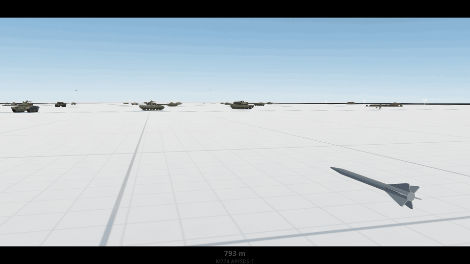

**[Скачать](../../releases/latest)** · [Установка](#установка) · [Что внутри](#что-внутри) · [Настройки](#настройки) · [Клавиши](#клавиши)

**[Заходи в неофициальный Discord по моддингу GHPC](https://discord.gg/BW2sgyCht7)**: обновления, WIP, релизы других модов и общение с моддерами и всем сообществом.

---

В GHPC самая подробная модель повреждений, какую я видел в играх про танки, и её почти никогда не видно. Выстрелил, цель встала, и всё.

Поэтому я начал с рентген-камеры с одним правилом: в ней ничего не выдумано. Мод записывает то, что игра просчитала для твоего выстрела, и показывает ровно это. Потом я добавлял то, чего мне самому не хватало в игре. В 2.0 мод добрался до всего остального: HUD, меню, карта, конец миссии.

Каждую часть можно выключить отдельно. При первом запуске выбираешь, как хочешь играть («Аркада», «Реалистично» или «Почти как в оригинале»), и вид, а мод настроится сам.

## Установка

**Нужно:** *Gunner, HEAT, PC!* сборка 20261014 и MelonLoader 0.7.x.

1. Поставь MelonLoader через [установщик MelonLoader](https://github.com/LavaGang/MelonLoader.Installer). Если он не находит игру, укажи ему `steamapps\common\Gunner HEAT PC\Bin\GHPC.exe`.
2. Запусти игру один раз и закрой.
3. Скачай `GHPCCombatOverhaul.dll` из [Releases](../../releases/latest) и положи в `Bin\Mods`.
4. Запусти игру.

GHPC Mod Manager тоже подходит.

**Обновление:** главное меню само предложит новую версию, настройки сохранятся. В Mod Manager нажми Update. Если обновление из игры не сработало, скачай `GHPCCombatOverhaul.dll` со страницы релиза и положи поверх старого в `Bin\Mods`. Обновлялка в 1.2.x сдаётся через 90 секунд, так что на медленном интернете качай вручную.

**Удаление:** удали `Mods\GHPCCombatOverhaul.dll`. Что останется, смотри в разделе [Файлы мода](#файлы-мода).

## Что внутри

### Камера снаряда

Лети за своим снарядом от орудия до цели в замедлении, потом камера плавно уходит прямо в рентген того, что он натворил внутри, без стоп-кадра. Она выключена, пока не нажмёшь V, и V включает и выключает её. Space пропускает. Как часто она включается, для какого оружия и с какой дистанции, решаешь ты, а «Когда показывать» может оставить её только для последнего врага или только по клавише V (Настройки > Камеры > Камера снаряда).

### Камера попаданий

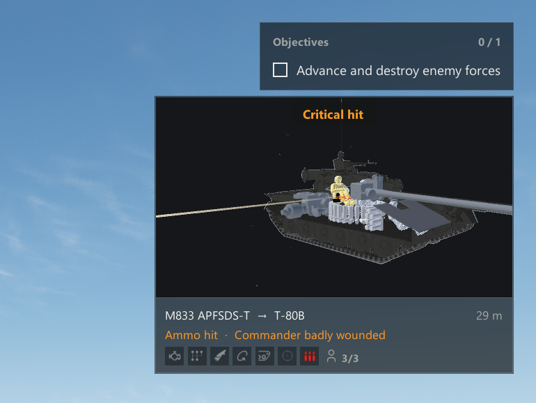

Маленькое окно рентгена в углу после твоих попаданий, как в War Thunder. Снаряд, плита, в которую он бьёт, каждый осколок, экипаж и модули, которые меняют цвет, когда игра их повреждает, пожары и детонация боеукладки. Под окном ряд значков: в каком состоянии цель сейчас. Всё это собственный расчёт игры для этого выстрела, записанный и показанный заново.

У длинных стержней поверх этого своя физика: они стираются, гнутся и ломаются в зависимости от материала (модель Тейта — Алексеевского), но идут по траектории игры, так что дыра там, где её сделала игра.

Десант в БТР и БМП тоже виден. Если один снаряд прошил две машины, покажут обе.

Попал в пехоту или расчёт ПТУР, и всё читается про людей: кого задело и как, без «Орудие» / «Башня». То же в Hit Log и в ленте уничтожений.

### Камера гибели

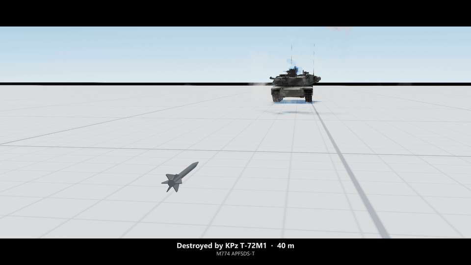

Когда тебя подбили: снаряд, который тебя достал, летит от их орудия в твой танк, потом рентген того, что он сделал, потом вид из-за орудия, которое стреляло. Любая клавиша пропускает.

### Боевой HUD

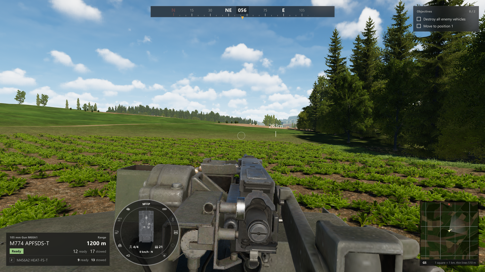

Орудие, снаряды и перезарядка, экипаж значками и модули, которые появляются, только когда что-то сломано. Полоса компаса и миникарта, обе с путевыми точками. Метки на замеченных врагах, союзники синим, с названием и дистанцией. Подписи как в War Thunder: просто цветной текст, без плашки. Индикатор пробития по броне самой игры и крест попадания по баллистике самой игры.

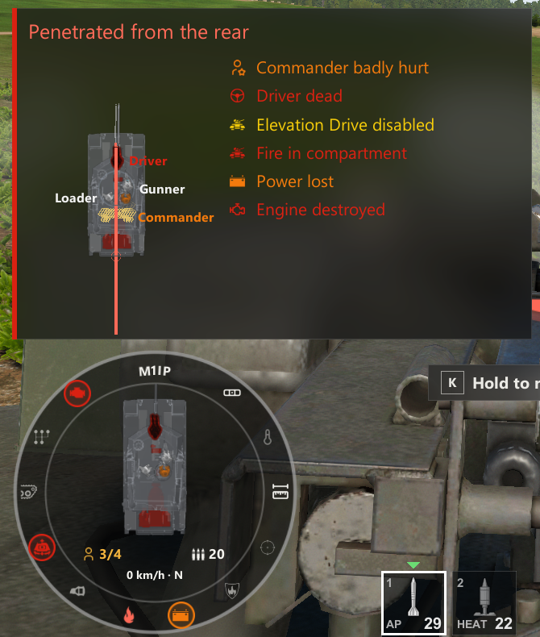

Если тебя пробили, панель повреждений рисует путь попадания на виде твоего танка сверху.

Alt+H открывает редактор HUD: выбери вид, включай и выключай части, двигай их и меняй размер. H включает и выключает помощь в прицеливании (метки, индикатор пробития, крест попадания). Можно оставить и HUD самой игры.

### Пять видов

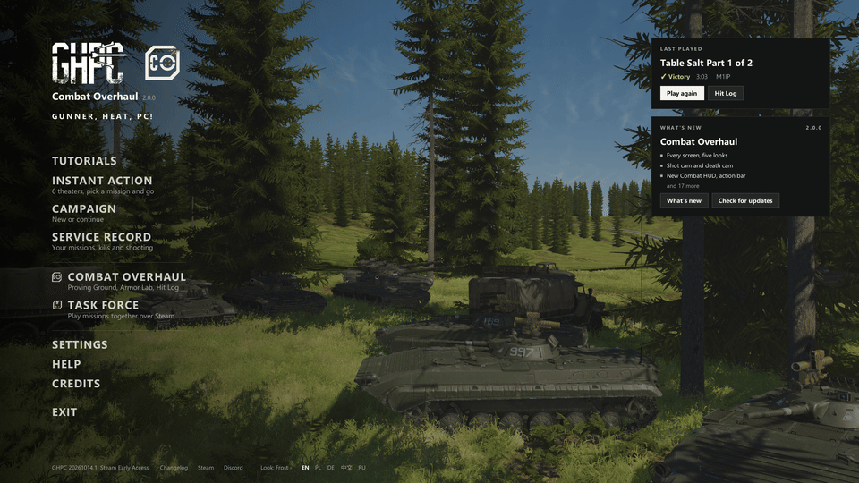

Frost, Fire control, Field manual, GHPC+ и Frontline. Каждый по-своему раскладывает главное меню, Instant Action, настройки, карту, послужной список и конец миссии, вплоть до полос прокрутки. Frontline ещё добавляет панель действий: снаряды, перезарядка, дым и ремонт в одном ряду. Или оставь меню самой игры.

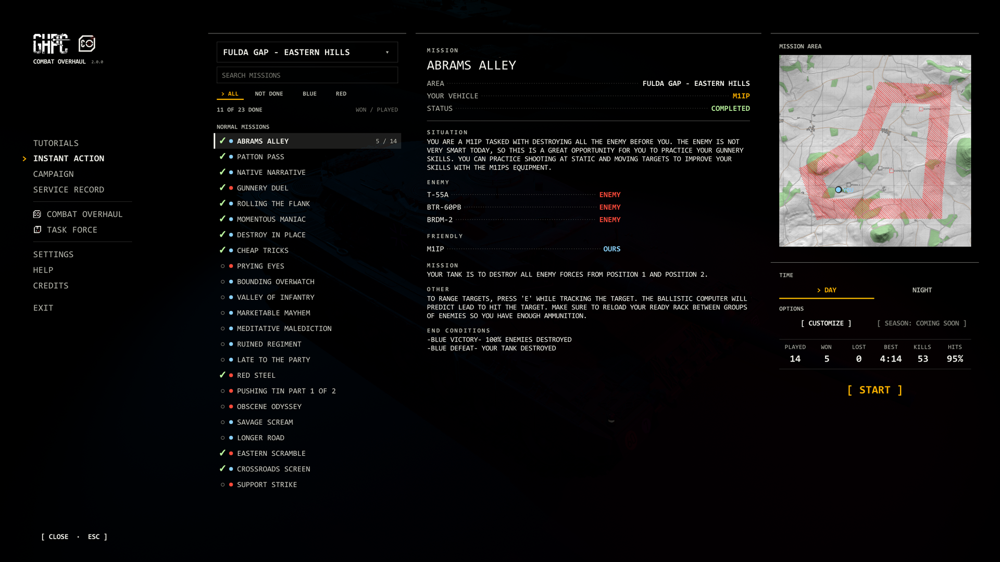

- **Главное меню:** последняя миссия с кнопкой «Сыграть ещё раз» и её Hit Log, что нового и твои моды.
- **Instant Action** на одной странице: все миссии со счётом побед и игр, поиск, брифинг, фото машин, карта района, сторона, время и Старт.
- **Послужной список:** миссии, уничтожения по типам, самый дальний фраг, точность, вызванная огневая поддержка, твои потери.
- **Карта:** задачи в одной колонке (нажми на задачу, и карта прыгнет к ней), брифинг, легенда, огневая поддержка и кодовые сигналы на выдвижных панелях.
- **Конец миссии:** баннер с итогом, потом результаты в твоём виде.

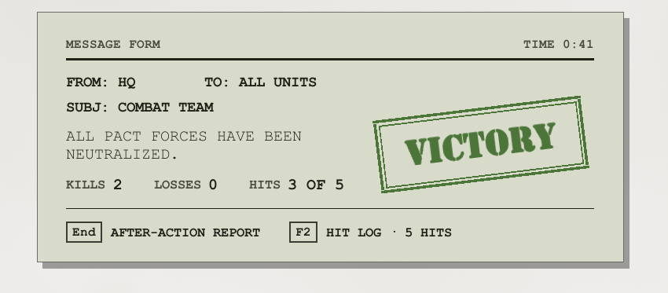

### Повреждения, которые остаются

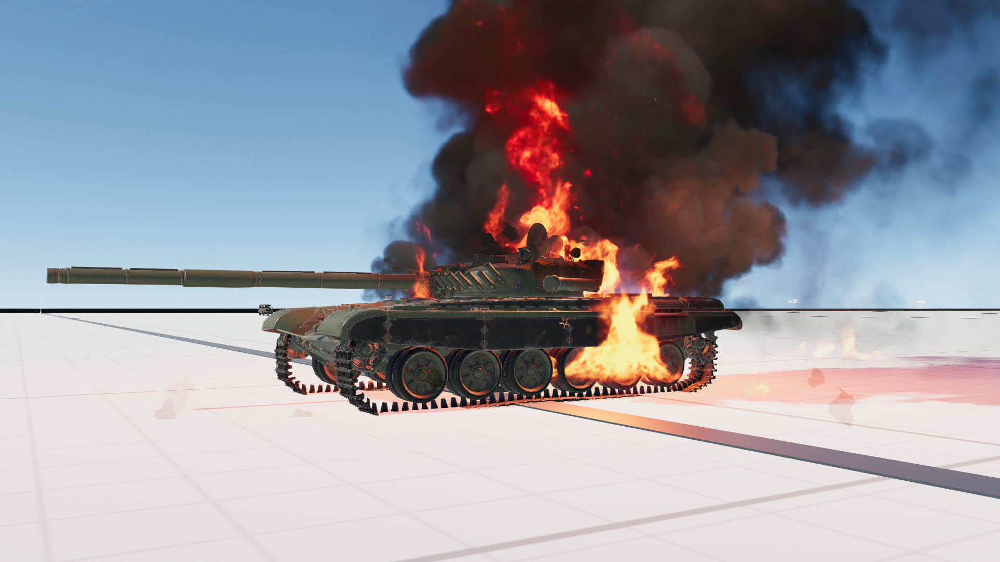

Настоящие пробоины, «лепестки» и борозды там, где вошли снаряды, пробитые и разорванные стволы, гусеницы, которые рвутся и слетают, горящие двигатели, пламя из пробоин. Это только вид, на решения игры он не влияет. Попадания ИИ друг по другу далеко от тебя (дальше 300 м) оставляют следы попроще, чтобы беречь FPS. Взрывы подогнаны под реальный заряд и доходят до тебя со скоростью звука.

Одно необязательное изменение самой игры: детонация боеукладки внутри машины убивает экипаж рядом с ней (по умолчанию включено).

### Hit Log

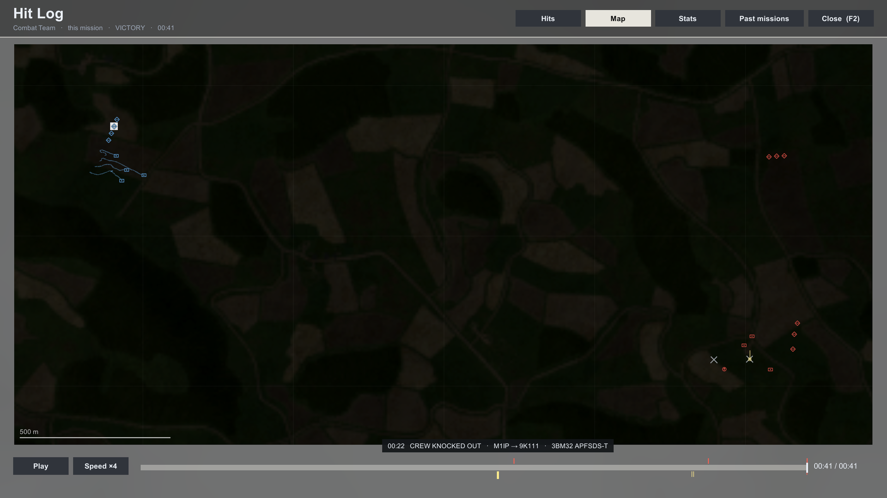

Нажми F2 во время миссии или после неё. Каждое твоё попадание и каждое по тебе, повтор в 3D со свободной камерой. И вся миссия сверху на шкале времени: кто куда ехал, каждое попадание линией от стрелка к цели. Нажми на попадание, чтобы увидеть повтор.

### Armor Lab

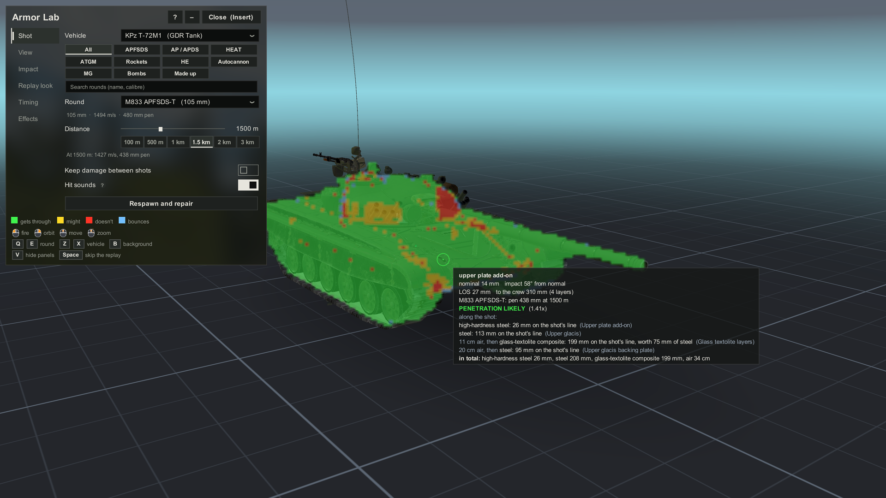

Любая машина, любой снаряд, любая дистанция: машина раскрашена по тому, где этот снаряд пробивает, по данным брони самой игры. Нажми на точку, чтобы выстрелить туда и посмотреть. Из главного меню или по Insert в миссии.

### Полигон

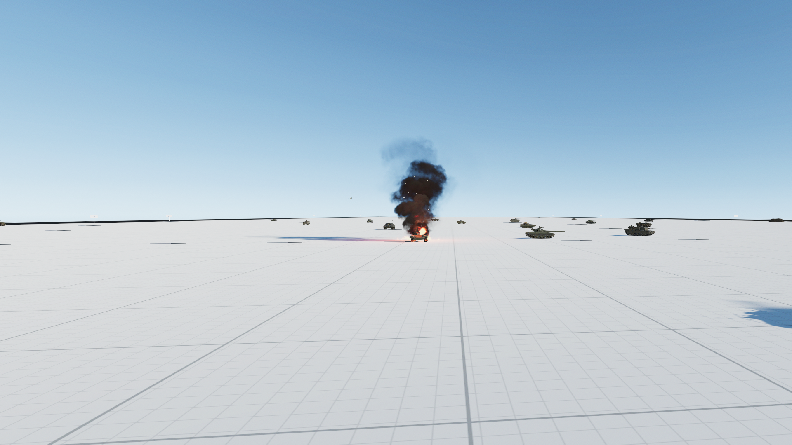

Стрельбище из главного меню: цели каждые 100 м, любая машина для тебя, свои цели и лаборатория выстрелов для любого снаряда под любым углом и с любой дистанции. Подбитые цели возвращаются сами.

### Мелочи

- Полевой ремонт на K.
- «Изображение и эффекты» в меню паузы: цветовые стили и ползунки.
- Арсенал (U) на полигоне и в Armor Lab: твоё орудие стреляет любым снарядом из игры.
- Фото машин в брифинге: наведи на подчёркнутое название.
- Английский, польский, немецкий, русский и китайский.
- «Что нового» и обновления в главном меню.

## Настройки

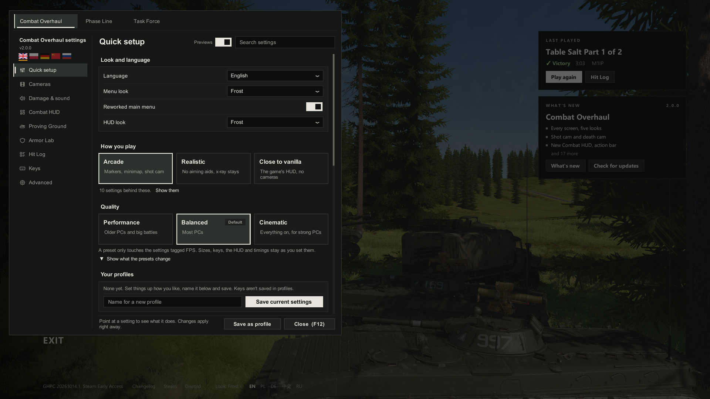

Нажми **F12**, в меню или в миссии. Ещё они есть в настройках самой игры, вкладка Overhaul.

В «Быстрой настройке» стиль игры, вид, язык, пресеты качества («Производительность», «Сбалансировано», «Кино») и проверка обновлений. Остальные страницы: Камеры, Повреждения и звук, Боевой HUD, Полигон, Armor Lab, Hit Log, Клавиши, Дополнительно. У каждой настройки есть строка о том, что она делает, а у тех, что съедают FPS, это написано.

## Клавиши

| Клавиша | |
|---|---|
| F12 | Настройки |
| Alt+H | Редактор HUD |
| H | Помощь в прицеливании вкл. / выкл. |
| V | Камера снаряда вкл / выкл |
| F9 | Камера попаданий вкл. / выкл. |
| F10 | Повторить последнее попадание |
| F2 | Hit Log |
| K | Полевой ремонт |
| Y | Большая карта |
| Num * / Num / | Приблизить / отдалить миникарту |
| Insert | Armor Lab |
| Home | Инструменты полигона |
| U | Арсенал (полигон, Armor Lab) |

Любую можно переназначить в Настройки > Клавиши. Клавиша, которую уже занимает игра или другой мод, показана красным.

## Файлы мода

Настройки лежат в `Bin\UserData\MelonPreferences.cfg`, раздел `[HitCam]`. Остальное в `Bin\UserData\HitCam`:

| | |
|---|---|
| `deathcam.log` | Почему камера гибели сработала или нет. Приложи его к баг-репорту про камеру гибели. |
| `record.txt`, `stats.txt` | Твой послужной список. |
| `maps\` | Картинка карты для каждой миссии, сохраняется при первом прохождении. |
| `topdown\`, `vehphotos\` | Картинки машин из других модов, которые мод сделал по твоей просьбе. |
| `aar_cache\` | Модели машин для повторов старых попаданий в Hit Log. |
| `profiles\` | Сохранённые профили настроек. |
| `sfx\` | Звуки мода. Чтобы заменить звук камеры попаданий, положи свой файл в `sfx\killcam\custom` под тем же именем. |
| `rounds_seen.json` | Снаряды, которые нашёл Armor Lab. |
| `update\` | Скачанное обновление, которое ждёт перезапуска. |

Прошлые миссии хранятся на диске, только если задать «Хранить прошлых миссий» (Настройки > Hit Log). Всю папку можно спокойно удалить: пропадут послужной список и картинки, больше ничего.

В сеть мод выходит ради одного: раз за запуск проверяет релизы этого проекта на GitHub (Быстрая настройка > Обновления: «Спрашивать», «Авто» или «Выкл.»).

## Совместимость

- [Phase Line](LINK_PL) (редактор миссий) и [Task Force](LINK_TF) (кооператив). У них с этим модом общий вид и общая страница «Что нового». Мины Phase Line видны в камере попаданий и в Hit Log, а её миссии грузятся на экране загрузки этого мода.
- **Fulda Expansion Pack** и **Pact Increased Lethality**: полигон и Armor Lab спавнят их машины, рентген видит их ДЗ и броню, а на фото в брифинге машина такая, какой её собирает мод. Сломанные остатки, которые их переделка оставляет на машине, убираются в Armor Lab и на полигоне, так что на карте пробития нет дыр, а у NPzK-140 видны внутренние стенки.
- **GHPC Mod Manager.**
- Другие моды на технику, сделанные так же, должны работать. Если какой-то не работает, открой issue.

## Полезно знать

- На слабых ПК при попаданиях бывает короткий фриз: рентген копирует машину в момент попадания. Пресет «Производительность» делает его меньше.
- В прицелах наводчика и командира боевой HUD по умолчанию скрыт. Зажми Alt, чтобы его увидеть, или поменяй в Настройки > Боевой HUD > HUD («Скрыто», «Бледно», «Показано»).
- Повреждения на машинах только визуальные. На модель повреждений игры они не влияют.
- Для очередей автопушек камера попаданий облегчённая: один рентген на всю очередь. Окно в углу ещё и показывает мелкие снаряды без плиты, а осколки рисует линиями; Hit Log, камера снаряда и камера гибели показывают всё полностью. «Детализация мини-рентгена» в Настройки > Камеры > Окно на «Полный» возвращает всё и в углу.
- Обновление игры может сломать часть мода, пока мод не обновится.
- Нашёл баг? Открой issue и приложи `Bin\MelonLoader\Latest.log`.

## Скоро

Времена года в миссиях самой игры: осень, зима, снег.

## Благодарности

- Radian Simulations, за игру про танки с такой подробной начинкой. Мод с ними никак не связан.
- Значки HUD: часть с [game-icons.net](https://game-icons.net), авторы Lorc, Delapouite, Skoll, Sbed и Quoting, лицензия [CC BY 3.0](https://creativecommons.org/licenses/by/3.0/); часть из [Tabler Icons](https://tabler.io/icons) (MIT). Некоторые наши, нарисованы для мода.
- Камера попаданий, камера гибели и части HUD вдохновлены War Thunder.
- Всем, кто тестировал сборки 2.0 и присылал логи.

## Лицензия

Все права защищены. Исходники закрыты, мод выходит только в виде DLL. Скачивать и играть можно бесплатно. Не перезаливай его на другие сайты. См. [LICENSE.txt](LICENSE.txt).

*Gunner, HEAT, PC!* и всё, что в ней есть, принадлежит Radian Simulations.
