[English](README.md) · [Русский](README.ru.md) · **简体中文**

# GHPC Combat Overhaul

**看清你这一炮到底打出了什么。**

弹道镜头、X 光命中镜头、阵亡镜头、全新 HUD，所有菜单全部重做。适用于 *Gunner, HEAT, PC!*

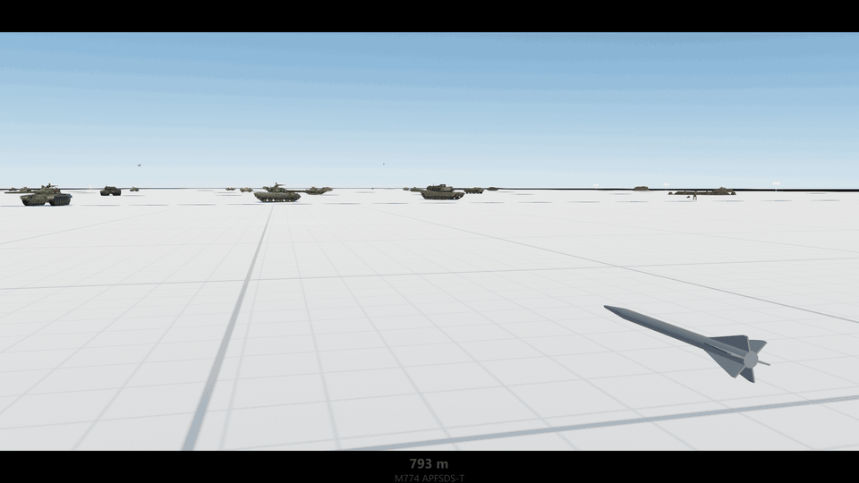

**[下载](../../releases/latest)** · [安装](#安装) · [模组内容](#模组内容) · [设置](#设置) · [按键](#按键)

**[加入非官方 GHPC 模组 Discord](https://discord.gg/BW2sgyCht7)**：更新、开发中的内容、其他模组发布，还能和模组作者以及整个社区聊天。

---

GHPC 的损伤模型是我在坦克游戏里见过最细的，可你几乎看不到它。开炮，目标停了，就没了。

所以我先做了一个 X 光镜头，只有一条规矩：里面没有任何编出来的东西。模组把游戏对你这一炮的模拟记录下来，再原样回放。后来我把自己玩的时候觉得缺的东西一点点加了进去。到了 2.0，它管到了游戏的其他部分：HUD、菜单、地图、任务结束画面。

每个部分都能单独关掉。第一次启动时选一下玩法（街机、真实或接近原版）和外观，模组会自己配置好。

## 安装

**需要：** *Gunner, HEAT, PC!* 版本 20261014 和 MelonLoader 0.7.x。

1. 用 [MelonLoader 安装器](https://github.com/LavaGang/MelonLoader.Installer)装好 MelonLoader。如果它找不到游戏，手动指向 `steamapps\common\Gunner HEAT PC\Bin\GHPC.exe`。
2. 启动一次游戏，然后关掉。
3. 从 [Releases](../../releases/latest) 下载 `GHPCCombatOverhaul.dll`，放进 `Bin\Mods`。
4. 启动游戏。

用 GHPC Mod Manager 也可以。

**更新：** 主菜单会提示有新版本，设置会保留。用 Mod Manager 的话点 Update。如果游戏内更新失败，到发布页下载 `GHPCCombatOverhaul.dll`，覆盖 `Bin\Mods` 里的旧文件。1.2.x 的更新器 90 秒后就会放弃，网速慢的话只能手动下载。

**卸载：** 删掉 `Mods\GHPCCombatOverhaul.dll`。会留下哪些文件，见[模组写入的文件](#模组写入的文件)。

## 模组内容

### 弹道镜头

用慢动作跟着你的炮弹从炮口飞到目标，然后镜头直接平滑切进 X 光，看它在里面干了什么，中间没有定格。默认关闭，按 V 打开或关闭，按 Space 跳过。多久播一次、哪些武器播、多远才播，都由你定；“何时播放”还可以设成只给最后一个敌人，或者只在按 V 时播（设置 > 镜头 > 弹道镜头）。

### 命中镜头

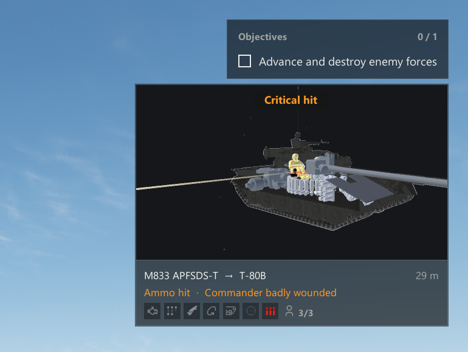

命中之后角落里弹出的 X 光小窗，War Thunder 那种。炮弹、它打中的装甲板、每一块破片、乘员和模块被游戏判定受损时变色、起火、弹药架殉爆。下面还有一排图标，显示目标现在的状态。这些全是游戏自己对这一炮的模拟，录下来再回放。

长杆弹芯另外有一套物理：按材料侵蚀、弯曲、折断（Tate-Alekseevskii 模型），但仍然沿着游戏算出的路径走，所以弹孔就在游戏打出来的位置。

装甲运兵车和步兵战车里搭载的步兵也会显示。一发炮弹打穿两辆车，两辆都会播。

打中步兵或反坦克导弹小组时，显示的是人：谁中弹、伤得怎样，不会再出现“火炮”“炮塔”。命中记录和击杀信息里也一样。

### 阵亡镜头

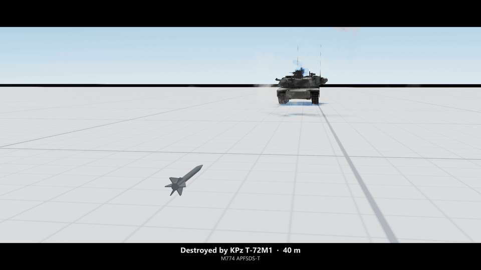

你被击毁时：打中你的那发炮弹从对方炮口飞进你的坦克，然后是它造成了什么的 X 光画面，最后是开炮那门炮后面的视角。按任意键跳过。

### 战斗HUD

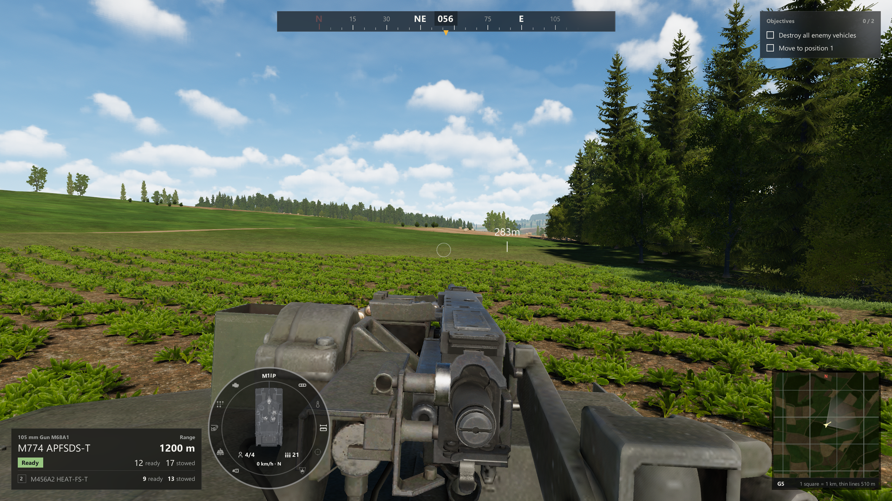

火炮、弹药和装填，乘员用图标显示，模块只在坏了的时候才出现。罗盘条和小地图，都带航点。已发现的敌人有标记，友军显示为蓝色，带名称和距离。标签是 War Thunder 风格：纯彩色文字，没有底框。击穿指示用的是游戏自己的装甲数据，落点十字用的是游戏自己的弹道。

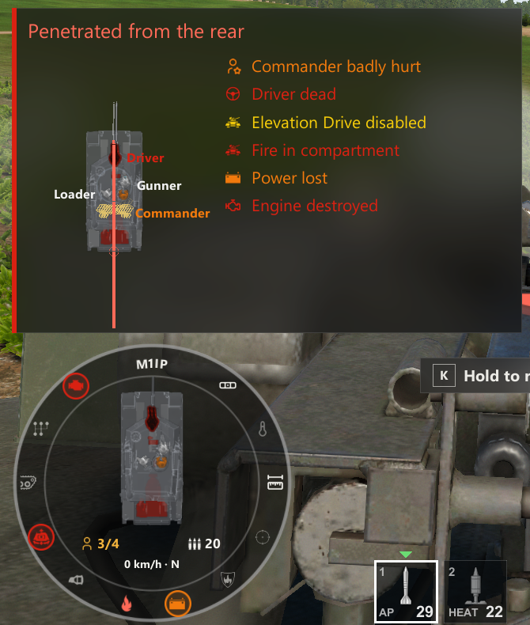

被击穿时，损伤面板会在你自己坦克的俯视图上画出这一炮的路径。

Alt+H 打开 HUD 编辑器：选外观、开关各个部分、移动和缩放。H 开关瞄准辅助（标记、击穿指示、落点十字）。也可以继续用游戏自带的 HUD。

### 五种外观

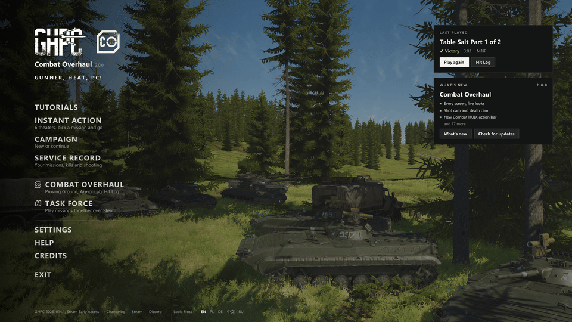

Frost、Fire control、Field manual、GHPC+ 和 Frontline。主菜单、Instant Action、设置、地图、服役记录和任务结束画面，每种外观都有自己的排法，连滚动条都是。Frontline 还多一条动作栏：弹药、装填、烟雾和维修都在一排。也可以保留游戏自带的菜单。

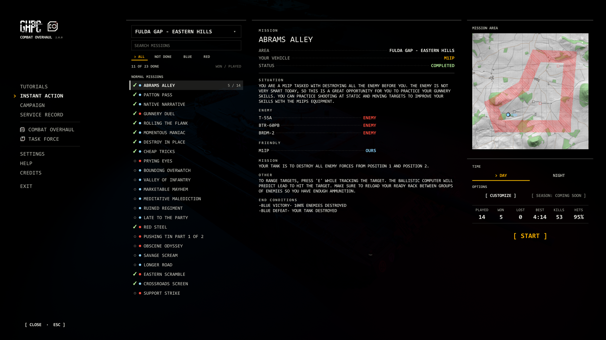

- **主菜单：** 上一场任务，可以再玩一次，也能打开它的命中记录；还有更新内容和你装的模组。
- **Instant Action** 合为一页：所有任务和你的胜场 / 场次、搜索、简报、参战载具的图片、任务区域地图、阵营、时间和开始。
- **服役记录：** 任务、分类击杀、最远击杀、命中率、呼叫过的火力支援、你的损失。
- **地图：** 目标排成一列（点一下，地图就跳过去），简报、图例、火力支援和行动暗号做成滑出面板。
- **任务结束：** 先出一条横幅告诉你打得怎么样，再用你的外观显示结果。

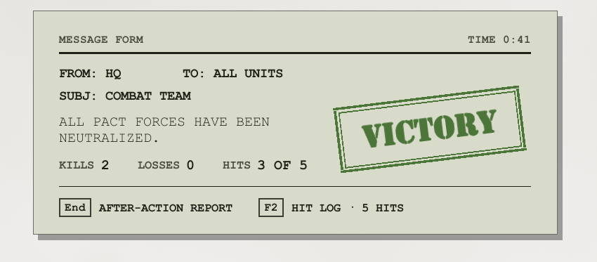

### 留在车上的损伤

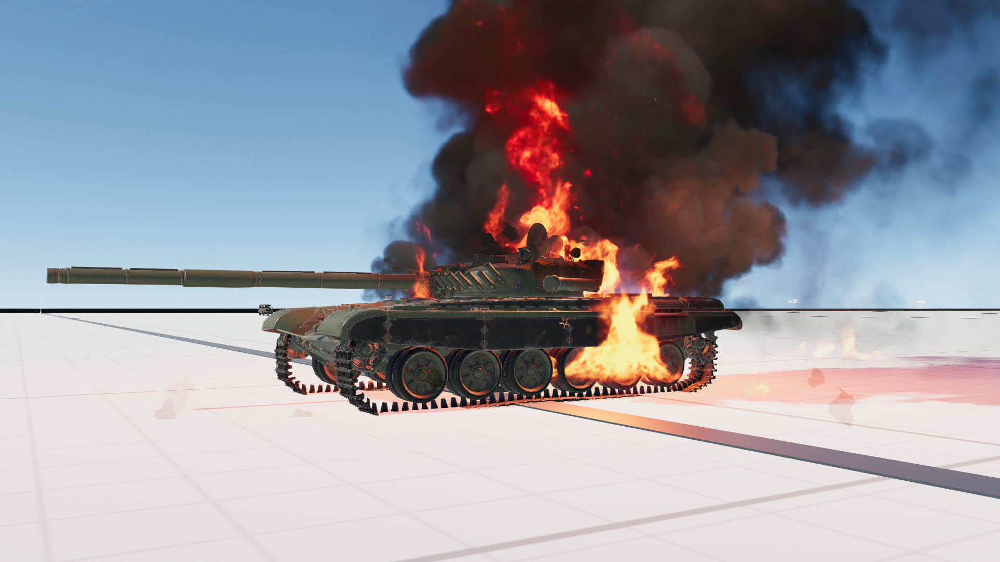

炮弹打进去的地方有真的弹孔、翻起的装甲花瓣和擦痕，炮管会被打穿、撕裂，履带会断掉脱落，发动机会烧，火会从弹孔里冒出来。这些只是视觉效果，不会改变游戏的判定。离你很远（300 米以外）的 AI 互相命中只留简化痕迹，省帧数。爆炸按真实装药量缩放，并以音速传到你这里。

对游戏本身只有一处可选改动：载具内弹药架殉爆会杀死附近的乘员（默认开启）。

### 命中记录

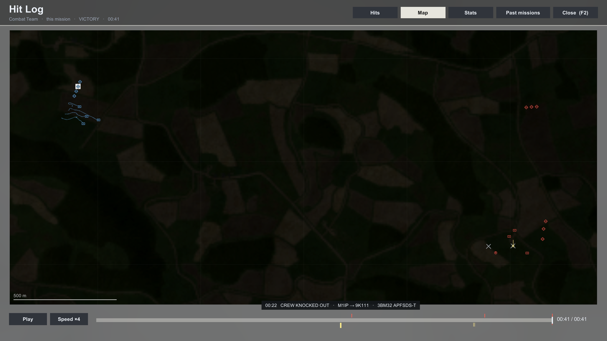

任务中或任务结束后按 F2。你的每次命中和你挨的每一炮，都能用自由镜头 3D 回放。还有带时间轴的整场任务俯视图：所有人的行动，每次命中是一条从射手到目标的线。点一次命中就能看回放。

### 装甲实验室

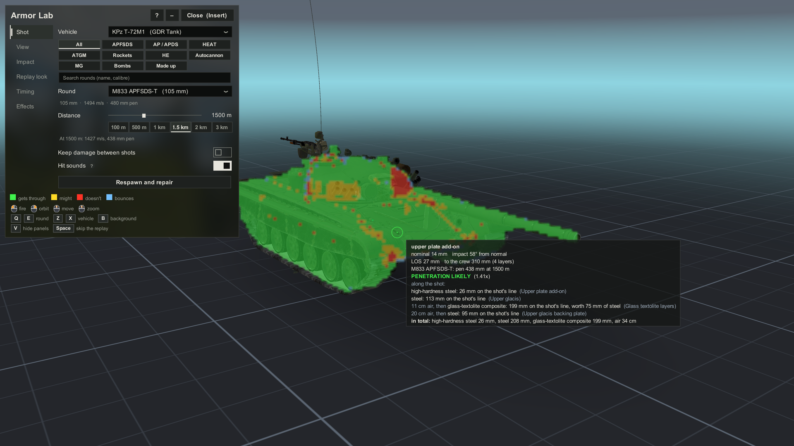

任意载具、任意弹药、任意距离：按这发弹能击穿的位置给载具上色，数据来自游戏自己的装甲。点一个位置就朝那里开一炮，看效果。从主菜单进入，任务中按 Insert。

### 试验场

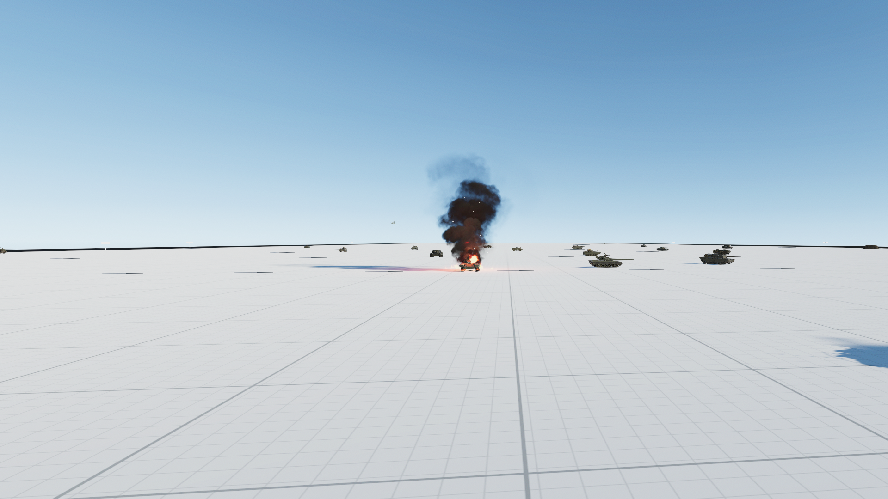

从主菜单进入的靶场：每 100 米一排靶标，任意载具自己开，靶标自己摆，还有射击实验室，任意弹药、任意角度、任意距离都能试。被击毁的靶标会自己恢复。

### 小东西

- 野战维修，按 K。
- 暂停菜单里的画面与效果：色彩风格和滑块。
- 试验场和装甲实验室里的军火库（U）：你的炮能打游戏里的任何弹药。
- 简报里的载具图片：把鼠标悬停在带下划线的名称上。
- 英语、波兰语、德语、俄语和中文。
- 主菜单里的更新内容和更新提示。

## 设置

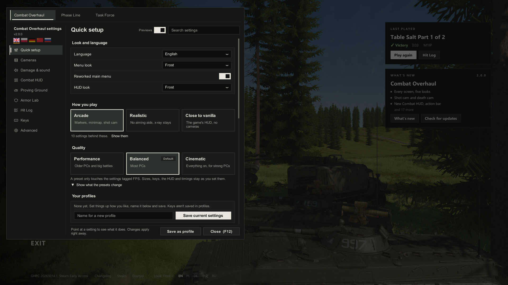

在菜单或任务中按 **F12**。游戏自带选项里的 Overhaul 标签页也能进。

快速设置里有游戏风格、外观、语言、画质预设（性能、均衡、电影）和更新检查。其他页面：镜头、损伤与声音、战斗HUD、试验场、装甲实验室、命中记录、按键、高级。每个选项都有一行说明，吃帧数的会标出来。

## 按键

| 按键 | |
|---|---|
| F12 | 设置 |
| Alt+H | HUD 编辑器 |
| H | 瞄准辅助开/关 |
| V | 弹道镜头开 / 关 |
| F9 | 命中镜头开/关 |
| F10 | 回放上一次命中 |
| F2 | 命中记录 |
| K | 野战维修 |
| Y | 大地图 |
| Num * / Num / | 小地图放大 / 缩小 |
| Insert | 装甲实验室 |
| Home | 试验场工具 |
| U | 军火库（试验场、装甲实验室） |

都可以在 设置 > 按键 里改。已经被游戏或其他模组占用的按键会显示为红色。

## 模组写入的文件

设置保存在 `Bin\UserData\MelonPreferences.cfg` 的 `[HitCam]` 下。其余都在 `Bin\UserData\HitCam`：

| | |
|---|---|
| `deathcam.log` | 阵亡镜头为什么播了或没播。反馈阵亡镜头的 bug 时请附上。 |
| `record.txt`、`stats.txt` | 你的服役记录。 |
| `maps\` | 每个任务一张地图图片，第一次玩时保存。 |
| `topdown\`、`vehphotos\` | 模组给其他模组的载具生成的图片（你让它生成的话）。 |
| `aar_cache\` | 命中记录回放旧命中时用的载具模型。 |
| `profiles\` | 你保存的设置配置。 |
| `sfx\` | 模组的音效。想替换命中镜头的音效，把你的文件用同样的文件名放进 `sfx\killcam\custom`。 |
| `rounds_seen.json` | 装甲实验室找到过的弹药。 |
| `update\` | 已下载、等待重启的更新。 |

只有设置了“保留的任务数”（设置 > 命中记录），以前的任务才会存到硬盘上。整个文件夹可以放心删：只会丢掉服役记录和图片，别的不受影响。

模组只为一件事联网：每次启动检查一次本项目的 GitHub releases（快速设置 > 更新：询问、自动或关）。

## 兼容

- [Phase Line](LINK_PL)（任务编辑器）和 [Task Force](LINK_TF)（合作模式）。它们和本模组共用一套外观和同一个更新内容页面。Phase Line 的地雷会显示在命中镜头和命中记录里，它的任务也用本模组的加载画面。
- **Fulda Expansion Pack** 和 **Pact Increased Lethality**：试验场和装甲实验室能生成它们的载具，X 光能看到它们的反应装甲和装甲，简报图片显示的是模组改装后的载具。这些模组改装载具时留下的损坏残余，在装甲实验室和试验场里会被清理掉，所以击穿图不再有空洞，NPzK-140 的内壁也能看到。
- **GHPC Mod Manager。**
- 其他用同样方式做的载具模组应该也能用。如果有不能用的，请开 issue。

## 须知

- 配置低的电脑命中时会卡一下：X 光要在炮弹命中的瞬间复制整辆载具。性能预设能让卡顿更短。
- 在炮手和车长瞄准镜里，战斗HUD 默认隐藏。按住 Alt 可以看到，或者在 设置 > 战斗HUD > HUD 里改（隐藏、淡化、显示）。
- 载具上留下的损伤只是视觉效果，不会反馈到游戏的损伤模型里。
- 机炮连射用的是轻量命中镜头：一整串只播一次 X 光。角落小窗里小口径弹也不显示装甲板，破片只画成线；命中记录、弹道镜头和阵亡镜头保留全部细节。把 设置 > 镜头 > 窗口 里的“小窗 X 光细节”设为“完整”，小窗也会恢复全部细节。
- 游戏更新后，模组没跟着更新之前，部分功能可能会坏。
- 发现 bug？请开 issue，并附上 `Bin\MelonLoader\Latest.log`。

## 即将推出

游戏自带任务的季节：秋季、冬季、雪。

## 致谢

- Radian Simulations，感谢他们做出一款底层这么细的坦克游戏。本模组与他们没有关联。
- HUD 图标：一部分来自 [game-icons.net](https://game-icons.net)，作者 Lorc、Delapouite、Skoll、Sbed 和 Quoting，按 [CC BY 3.0](https://creativecommons.org/licenses/by/3.0/) 授权；一部分来自 [Tabler Icons](https://tabler.io/icons)（MIT）。还有一些是我们自己为模组画的。
- 命中镜头、阵亡镜头和部分 HUD 的灵感来自 War Thunder。
- 所有测试过 2.0 版本并发来日志的人。

## 许可

保留所有权利。模组不开源，只发布 DLL。可以免费下载和游玩。请不要转载到其他地方。见 [LICENSE.txt](LICENSE.txt)。

*Gunner, HEAT, PC!* 及其全部内容归 Radian Simulations 所有。
